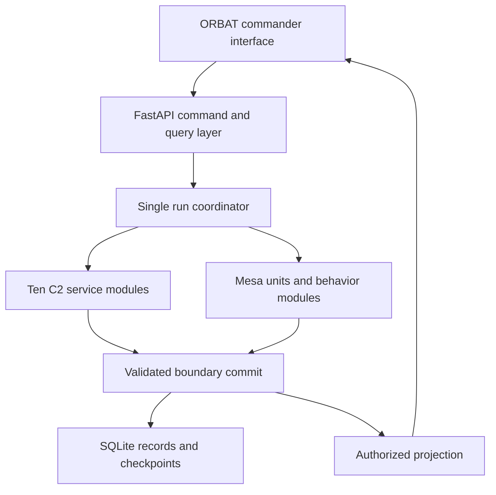

# C2 State Machine Implementation Plan for Mesa and ORBAT Mapper

Version 1.0 | 11 October 2026 | Status: proposed implementation

## 1. Purpose and source baseline

Build a working joint tactical C2 simulator from the two companion documents:

- [Joint Tactical C2 System — Design and Operation Guide](joint-tactical-c2-design-and-operation-guide.md): defines the ten services, mission workflow, task workflow, and commander actions.
- [Mesa and ORBAT Mapper Simulation Framework](mesa-orbat-mapper-framework-documentation.md): defines simulation ownership, time, commands, projections, recording, and the ORBAT integration boundary.

This plan turns those requirements into a concrete software design, implementation backlog, and acceptance procedure. It preserves the service names and responsibilities. It specifies how to implement the C2 workflow inside the Mesa pipeline and how to expose it through ORBAT Mapper.

The source repository contained those two documents and no application code when inspected. All package paths, endpoints added here, interfaces, and delivery milestones below are proposed work. They are not claims about an existing implementation.

Source baseline: repository commit `d4c47d2c66152e79f16af1b3a30d0e66b9fcc394`. The C2 guide has Git blob SHA `aeca6667d61ec2b03969c1c2d117278d04b2d1d9`. The framework guide has Git blob SHA `b07cc9800d774334cae674e2e33d8566a1d55b0d`.

Use the operational guide for commander and task semantics. Use the framework guide for runtime semantics. The explicit refinements in this plan resolve implementation gaps: preliminary task authorization, plan replacement, reported versus actual task state, persistence, and commands while the simulation clock is stopped.

## 2. Concrete first release

Deliver one local application that can run the coastal resupply example from the operational guide. A commander organizes forces, reviews delivered information, approves tasks, dispatches them, handles an unavailable crossing, approves a revised plan, and records completion.

Use these implementation choices:

| Area | First-release choice |
|---|---|
| Backend | Python 3.12, Mesa 3.5.1, FastAPI, Pydantic 2 |
| State machines | Python enums, explicit transition registries, pure guard functions, and reducers |
| Service deployment | Ten Python service modules in one backend process |
| Simulation | One active run and one serialized coordinator; fixed `dt_ms=1000` |
| Persistence | SQLAlchemy 2, Alembic migrations, SQLite in WAL mode on a local persistent volume |
| Frontend | Maintained ORBAT Mapper integration fork, Vue 3, TypeScript, Pinia |
| Transport | REST commands and queries; WebSocket full snapshots |
| Geometry | pyproj transformations; authored routes represented as projected polylines |
| Tests | pytest for backend behavior; upstream Vitest tooling for the bridge; Playwright for the complete workflow |
| Packaging | Docker Compose with frontend/proxy and one backend worker |

Pin all resolved dependencies in lockfiles. The inspected ORBAT candidate is commit `c5255c7403907a872450775f744e115b8448b690`. Its manifest specifies Node `>=22.12.0`, pnpm `>=10.25.0`, and package manager `pnpm@10.26.2`. Treat this as the integration starting point, subject to the Phase 1 compatibility check, not as an already tested combination. [U1–U4]

Use a modular monolith. Do not deploy ten network services. Internal services share the coordinator's transaction boundary and simulation clock. Mesa models the units and environment; it does not provide the C2 business rules. ORBAT provides the visual application; it does not own execution state.

The first release includes all ten services, delayed orders and reports, preliminary collection, plan revision, pause and cancellation, durable recovery, recorded review, and export. Keep direct or authored-route movement and fixed-duration activities. Defer terrain-derived route optimization, detailed platform physics, combat adjudication, autonomous planning, a general plugin marketplace, distributed workers, and simultaneous runs.

## 3. Architecture and code ownership



The diagram shows responsibilities, not separate processes. Only the coordinator can commit changes. C2 services produce decisions and events. Mesa behavior produces simulated effects. Neither API handlers nor Vue components write agent fields.

Use the following project layout. Add it during implementation; this documentation change does not create these packages.

| Proposed path | Responsibility |
|---|---|
| `backend/src/c2sim/contracts/` | Pydantic commands, events, snapshots, scenario schemas, schema generation |
| `backend/src/c2sim/domain/` | Records, enums, transitions, guards, dependency validation |
| `backend/src/c2sim/services/` | Ten C2 service modules and shared task lifecycle engine |
| `backend/src/c2sim/runtime/` | Coordinator, operation queue, clock, boundary transactions |
| `backend/src/c2sim/simulation/` | Mesa model, agents, module registry, movement and activity policies |
| `backend/src/c2sim/adapters/orbat/` | Native import/export mapping and coordinate conversion |
| `backend/src/c2sim/persistence/` | SQLAlchemy models, repositories, inbox, journal, checkpoints |
| `backend/src/c2sim/projections/` | Commander, unit, instructor, and review projections |
| `backend/src/c2sim/api/` | REST handlers, WebSocket subscriptions, identity context |
| `backend/migrations/` | Alembic migrations |
| `frontend/orbat-mapper/` | Vendored integration fork with upstream history retained through a Git subtree |
| `frontend/orbat-mapper/src/c2sim/` | Client, generated types, runtime store, bridge, panels |
| `schemas/` | Generated JSON Schema and contract fixtures |
| `scenarios/coastal-resupply/` | Native source, normalized scenario, C2 configuration, scripts, expected results |
| `tests/` | Integration, recovery, scenario, and browser acceptance cases |
| `deploy/` | Compose, proxy configuration, container builds, volume configuration |

Domain code must not import FastAPI, SQLAlchemy, Mesa, or Vue-specific contracts. Services depend on narrow repository and command interfaces. Simulation policies depend on immutable domain views. The composition root binds implementations. This keeps domain rules independently testable and allows later storage or process changes.

## 4. Place the ten services in the pipeline

Use the exact service numbering below. Each module owns its records and changes them only through coordinator-dispatched handlers.

| Service | Module | Authoritative records | Initial commands and events | Simulation connection |
|---|---|---|---|---|
| 1. Mission Control | `mission_control.py` | Mission, approvals, authorizations, decision points | `mission.create`, `mission.confirm_forces`, `mission.accept_basis`, `mission.approve_plan`, `mission.authorize_execution`; `MissionStateChanged`, `DecisionPointRaised` | Evaluates delivered evidence and controls task-start permission |
| 2. Force Organization | `force_organization.py` | Assignments, hierarchy, reported readiness, resource reservations | `force.attach`, `force.assign_role`; `ForceAssignmentChanged`, `ReadinessReported` | Imports ORBAT organization; separates reported availability from actual simulated resources |
| 3. Position Tracking | `position_tracking.py` | Friendly position report history and latest valid delivered position | `position.report`; `PositionUpdated`, `PositionStale`, `CheckpointReported` | Consumes delayed unit position reports; never supplies hidden truth as a commander position |
| 4. Tactical Reporting | `tactical_reporting.py` | Reports, corrections, confirmation status, information requirements | `report.submit`, `report.correct`, `report.confirm`; `ReportReceived`, `ReportCorrected` | Receives observations and activity results through communications |
| 5. Terrain and Mobility | `terrain_mobility.py` | Known routes, reported restrictions, validity periods | `terrain.record_condition`; `RouteConditionChanged` | Provides the known mobility picture; simulation separately enforces actual route conditions |
| 6. Task Planning | `task_planning.py` | Immutable approved plans, dependency graph, task specifications | `plan.create`, `plan.revise`, `plan.validate`; `PlanProposed`, `PlanValidated` | Converts approved task specifications into requests to domain tasking services |
| 7. Intelligence Tasking | `intelligence_tasking.py` | Intelligence task instances and linked findings | `task.issue`, `task.report`; `IntelligenceFindingDelivered` | Collection activity links findings to a requirement; linked air/land/sea tasks own their assets |
| 8. Air Force Tasking | `air_force_tasking.py` | Air task instances | `task.issue`, `task.report`; `TaskAccepted`, `TaskCompleted` | Airlift and aerial observation policies |
| 9. Navy Tasking | `navy_tasking.py` | Maritime task instances | `task.issue`, `task.report`; `TaskAccepted`, `TaskCompleted` | Sea transport and unload policies |
| 10. Army Tasking | `army_tasking.py` | Land task instances | `task.issue`, `task.report`; `TaskBlocked`, `TaskCompleted` | Engineering checks, ground movement, delivery, and receipt policies |

Services 7–10 use one `TaskLifecycleEngine`, with a policy object for domain-specific validation and behavior selection. Keep ownership with the corresponding service. Do not copy four independent transition implementations or implement all service responsibilities in a generic handler.

Use typed, in-process dispatch. Handle cross-service effects in a declared order within one candidate boundary. For example, a delivered engineering report updates Tactical Reporting, then Terrain and Mobility, then affected task records, then the decision queue. Do not use recursive event callbacks with unspecified ordering. Persist the resulting ordered events together.

## 5. Records and contracts

### 5.1 Identity, versions, and time

All runtime records carry `run_id`. C2 records additionally use stable `mission_id`, `plan_id`, `task_id`, `entity_id`, `report_id`, `command_id`, or `event_id` as applicable. Use imported ORBAT unit IDs as entity IDs after uniqueness validation. Keep Mesa's internal agent ID out of public contracts.

Distinguish an immutable content version from a concurrency revision. `plan_version` and `task_version` identify issued content. `mission_revision` and `task_revision` change as workflow state changes. `control_revision` changes for run controls. `commit_seq` orders all committed boundaries. `state_seq` orders messages within a projection stream. These counters are not interchangeable.

Use integer milliseconds for simulated time. Reports retain `observed_time_ms`, `sent_time_ms`, and `delivered_time_ms`. Audit records also retain UTC wall-clock receipt time. A stopped simulation does not accumulate simulated communication delay or position age.

### 5.2 Minimum persisted records

| Record | Required content beyond identity |
|---|---|
| `Mission` | State, revision, objectives, deadline, completion predicates, commander, current main plan reference |
| `PlanVersion` | Scope, immutable task specifications, dependency graph, initial-required set, assumptions, approval status and content hash |
| `TaskVersion` | Domain, assigned element, activity, parameters, criteria, dependencies, material-change flag, predecessor version |
| `TaskExecution` | Reported lifecycle state, revision, acknowledged/accepted/executing versions, report sequence, progress, evidence |
| `UnitExecution` | Actual installed task version, local execution phase, position, resources, last processed instruction, report sequence |
| `Authorization` | Commander, exact task-version scope, plan reference, allowed start conditions, validity interval, revocation record |
| `Instruction` | Issue/change/start/pause/resume/cancel type, destination, task version, due time, sequence, delivery status |
| `TaskDisposition` | Pause/cancel request, requested time, effective time, confirmation receipt, partial result, permitted continuation |
| `DecisionPoint` | Reason code, affected objective/tasks, evidence IDs, severity, status, commander resolution |
| `Report` | Original content, source, all timestamps, confirmation, correction link, task-version link, visibility |
| `ResourceReservation` | Entity/resource, amount, task version, effective interval, release condition |
| `BoundaryCommit` | Commit sequence, time, input IDs, ordered events, state hash, checkpoint reference |

Keep task specifications separate from their execution state. A tasking service owns the authoritative C2 task record. The Mesa unit owns simulated actual execution. A commander may still see `ACCEPTED` while the unit has started and its progress report is in transit. Preserve both facts; do not update the commander record directly from agent truth.

Approval records reference the plan hash, commander identity, evidence used, and decision time. Corrections append a new report. They do not overwrite the original evidence.

### 5.3 Structured conditions

Represent criteria as a small validated predicate language. Initial operators are `all_of`, `any_of`, `task_completed`, `report_confirmed`, `supply_received`, and `element_accounted_for`. Dependency edges identify an exact task version and required result or milestone. Never execute Python expressions provided in scenario files.

Separate task acceptance from start dependencies. A ground unit can accept an assignment before sea delivery finishes. Its start remains blocked until the declared dependency evidence is available. This prevents a circular wait in the mission-start guard.

Validate the dependency graph as a directed acyclic graph. Reject self-dependencies, missing references, incompatible domains, duplicate task versions, resource conflicts, and invalid quantities. An explicitly recorded commander exception can permit planning with uncertain reported readiness; it cannot create actual resources or bypass the simulation's capacity invariant.

## 6. Three independent state machines

### 6.1 Run lifecycle

Retain `READY`, `RUNNING`, `PAUSED`, `COMPLETED`, `STOPPED`, and `FAILED` from the framework guide. The coordinator owns them. A run pause freezes simulation time, movement, communications, and deadlines at a committed boundary.

Do not automatically end the run when its mission becomes terminal. Continue long enough to receive delayed reports and cancellation confirmations. For the demo, run completion requires a terminal mission, resolved task dispositions, and no remaining required deliveries. The operator can instead stop the run explicitly.

### 6.2 Mission lifecycle and guards

Mission creation enters `ORGANIZING`. Implement the following complete transition registry. All transitions except automatic entry into review require an authorized commander command. Automatic review is the guide's decision-point behavior; it grants no new execution authority.

| From | Trigger | To | Required checks |
|---|---|---|---|
| `ORGANIZING` | `mission.confirm_forces` | `REVIEWING_SITUATION` | Objectives, criteria, commander, attachments, and readiness review are recorded |
| `REVIEWING_SITUATION` | `mission.accept_basis` | `PLANNING_TASKS` | Evidence set and acknowledged information gaps are recorded |
| `PLANNING_TASKS` | `mission.approve_plan` | `DISPATCHING_DOMAIN_TASKS` | Exact main plan version is valid; dependencies and reservations pass; approval recorded |
| `DISPATCHING_DOMAIN_TASKS` | `mission.authorize_execution` | `EXECUTING` | Required initial tasks accepted at exact versions; resources rechecked; authorization scope recorded |
| `EXECUTING` | Decision-point event | `COMMANDER_REVIEW` | Material condition has linked evidence and affected tasks/objectives |
| `COMMANDER_REVIEW` | `mission.continue` | `EXECUTING` | Commander resolves or explicitly acknowledges relevant decisions; surviving authorization is valid |
| `COMMANDER_REVIEW` | `mission.replan` | `PLANNING_TASKS` | Revision reason and affected task set recorded |
| `COMMANDER_REVIEW` | `mission.request_information` | `REVIEWING_SITUATION` | Information gaps and requested collection recorded |
| `COMMANDER_REVIEW` | `mission.complete` | `COMPLETED` | All completion criteria and outstanding dispositions resolved with evidence |
| `EXECUTING` or `COMMANDER_REVIEW` | `mission.pause` | `PAUSED` | Pause scope and explicit permitted continuations recorded |
| `PAUSED` | `mission.continue` | `EXECUTING` | Commander approves continuation; authorizations and required acceptance remain valid |
| `PAUSED` | `mission.replan` | `PLANNING_TASKS` | Revision reason and affected task set recorded |
| Any nonterminal mission state | `mission.cancel` | `CANCELLED` | Commander reason recorded; new-start prohibition and cancellation instructions created |

No outgoing execution transition exists from `COMPLETED` or `CANCELLED`. Reports and disposition updates remain allowed. When completion evidence arrives during execution, create a decision point and enter review; do not complete the mission automatically.

Use a pure evaluator such as `evaluate_mission_transition(mission, command, known_state) -> TransitionDecision`. The decision includes allowed/rejected status, stable reason codes, evidence references, and proposed events. Applying that decision is a separate coordinator operation. Rejected guards leave mission state and revision unchanged, while the rejection remains in the command audit.

Do not implement a generic endpoint that sets an arbitrary mission state. Expose the named actions above. The frontend displays available actions and guard failures supplied by the backend.

### 6.3 Shared task lifecycle

Retain `DRAFT`, `ISSUED`, `ACKNOWLEDGED`, `ACCEPTED`, `IN_PROGRESS`, `BLOCKED`, `COMPLETED`, `FAILED`, and `CANCELLED`.

| From | Evidence or action | To |
|---|---|---|
| `DRAFT` | Approved task dispatched by its owning service | `ISSUED` |
| `ISSUED` | Delivered acknowledgement for the issued version | `ACKNOWLEDGED` |
| `ACKNOWLEDGED` | Delivered acceptance for the acknowledged version | `ACCEPTED` |
| `ACCEPTED` | Delivered start report with valid execution authorization | `IN_PROGRESS` |
| `IN_PROGRESS` | Delivered completion report satisfying criteria | `COMPLETED` |
| `ISSUED`, `ACKNOWLEDGED`, `ACCEPTED`, or `IN_PROGRESS` | Delivery failure or inability to perform, with reason | `FAILED` |
| `ACKNOWLEDGED`, `ACCEPTED`, or `IN_PROGRESS` | Delivered blocking condition | `BLOCKED` |
| `BLOCKED` | Delivered resolution and revalidated conditions | Recorded prior applicable state |
| Any nonterminal task | Confirmed effective cancellation, or proven withdrawal before delivery | `CANCELLED` |

A blocked task may also fail or complete after a valid result arrives. Use causal report sequences to validate these cases. Terminal states never regress. A report for an old version stays in history and cannot change the current version's state.

An acknowledgement and acceptance may be delivered together, but retain both logical transitions in order. Buffer out-of-order task lifecycle reports by task version and unit report sequence. Under the fixed-delay baseline, delivery order is stable. Before adding communication loss, implement retransmission or a versioned reconciliation report so a missing acknowledgement cannot block the record forever.

Pause is a disposition, not a new task lifecycle state. A paused activity can remain `IN_PROGRESS` with `pause_status=CONFIRMED`. Use `BLOCKED` for an obstacle, not merely because the commander requested a pause.

### 6.4 Execution authorization and plan changes

A unit can start only after it has received the applicable task version, accepted it, received start authority, and passed dependency/resource checks. The coordinator also applies the mission's new-start prohibition. Physical restrictions can block execution even when the commander has not yet learned about them; the cause reaches the commander through a report.

The simulator models command friction, not deliberate disobedience. A committed mission pause or cancellation prevents new starts immediately at the coordinator gate. Already active tasks continue until their delayed pause/cancel instruction takes effect. Record this simplification in the scenario manifest. Do not turn a pause request into instant physical stopping.

Define preliminary collection as a separate plan with `scope=PRELIMINARY`. The commander approves and authorizes an exact task set during `REVIEWING_SITUATION` using `mission.authorize_preliminary`. That action does not advance the main mission state. It can include linked air, maritime, or land tasks. Intelligence Tasking cannot take ownership of those assets. Preliminary authorization still obeys all task guards, resource checks, and pause/cancel rules.

For main-plan revision, use this protocol:

1. Create a new draft plan version. Keep the approved version immutable.
2. Classify each task as unchanged, changed, added, or removed.
3. Reference unchanged task versions directly in the new plan. Preserve their progress and authority.
4. Create a new task version for each material change. Do not overwrite the version currently executing.
5. Record removed-task dispositions explicitly; exclusion from a new plan does not cancel a task.
6. Approve the new plan and reserve changed resources atomically.
7. Dispatch changes. Obtain acknowledgement and renewed acceptance for material changes.
8. Authorize the new scope. Switch a changed task's installed execution version only at a declared unit boundary after authority arrives.
9. Release replaced reservations only when the old activity has ceased or an explicit handover permits it.

Default policy for changed tasks: their existing version continues until explicit hold/cancel takes effect. Unchanged tasks retain authority during review and planning. For tasks that have not started, revalidate membership in the applicable approved or explicitly carried-forward scope before permitting start. These rules prevent a global plan pointer from silently stopping an aircraft or authorizing an unaccepted revised route.

## 7. Integrate C2 into the Mesa interval

### 7.1 Model and agents

Implement `C2SimulationModel(mesa.Model)` and `UnitAgent(mesa.Agent)`. Agents represent located units or platforms. Organizational nodes without a physical role remain domain records. Services and missions are not Mesa agents merely because they have state.

Each unit uses policies for readiness, order acceptance, movement/activity, resources, and reporting. Start with a trusted factory registry: `movement.route`, `activity.wait`, `activity.inspect`, `activity.collect`, `activity.load`, `activity.unload`, and `communications.fixed_delay`.

Initialize Mesa through its superclass and keep external entity lookup separate from `model.agents`. Use a framework clock and a serializable scheduled-message heap; do not manually increment Mesa-owned bookkeeping. Do not run a second independent scheduler. [U5, U6]

Store queue entries as data: `(due_time_ms, admission_seq, message_index, message_id)`. Store payloads in records, not callable closures. This makes pending work checkpointable. Use stable entity ordering and run-controlled randomness.

### 7.2 Exact boundary order

For an interval starting at `T`, perform the following sequence:

1. **Admission:** apply queued headquarters commands assigned to `T` in recorded admission order. Recheck their expected revisions and guards. Create outgoing instructions but do not deliver newly created messages in this same phase.
2. **Delivery:** consume messages already scheduled and due at or before `T`. Deliver unit instructions to unit execution records and reports to their authorized recipients. Preserve occurrence time separately from this delivery time.
3. **C2 update:** apply delivered evidence to services 2–10, evaluate dependencies and decision points, and update Mission Control. Deduplicate decisions by condition, task version, and evidence identity.
4. **Start and continuation checks:** evaluate exact task-version authority, reported dependency evidence available to the execution controller, pause/cancel gates, and actual resource constraints. Resolve competing reservations deterministically.
5. **Behavior proposals:** agents read immutable boundary input and propose movement, activity progress, or resource changes for `[T, T + dt_ms]`.
6. **Resolution:** validate and combine proposals. No negative resources, invalid coordinates, duplicate payload transfers, or competing exclusive tasks are permitted.
7. **Observation and reporting:** sample the candidate state at `T + dt_ms`. Generate observations, position messages, and task-result messages. Schedule delivery for a later delivery phase, including when configured delay is zero.
8. **Durable commit:** persist candidate state, queues, input outcomes, events, and state hash in one transaction. Advance the public clock only with the successful commit.
9. **Publication:** expose immutable authorized projections and collect metrics from the committed result.

Initial acceptance reports are asynchronous. API admission, order delivery, acceptance at the element, receipt at headquarters, actual execution, and reported completion are separate events.

A due time of 2500 ms delivers at the 3000 ms boundary with a 1000 ms interval. An end-state observation at 3000 ms with 2000 ms report delay is eligible for the delivery phase at 5000 ms. Its effect becomes visible in the resulting committed projection; retain both the 5000 ms delivery time and that projection's end boundary.

### 7.3 Headquarters operations while the clock is stopped

Mission planning must work in `READY` and run `PAUSED`. Allow authorized headquarters commands to commit a control-only boundary at unchanged simulation time. Increment `commit_seq` and affected aggregate revisions, but do not move agents, deliver queued messages, age positions, or consume resources.

Outgoing instructions created at a control-only boundary wait for simulation advancement. Thus a commander can approve and issue a plan while paused, but cannot obtain simulated acceptance until stepping or resuming the run. A run pause differs from a mission pause: the former stops time; the latter permits time and active-task dispositions to progress.

### 7.4 Atomicity and failure

For the toy workload, stage a complete candidate state and checkpoint each committed boundary. Include service records, agents, queues, random generator states, counters, and module state. This deliberately favors reliable recovery over maximum throughput.

Do not publish a candidate before its database transaction succeeds. If behavior or persistence fails, discard the candidate and rebuild the Mesa instance from the last committed checkpoint if any working state was mutated. Record run failure separately when storage is available. A successful database commit followed by a process crash recovers from that commit, even if no browser received it.

Do not promise rollback by merely hiding a partial snapshot. Keep external side effects out of the interval; the first release only simulates deliveries. A future external adapter requires an outbox and idempotent destination handling.

## 8. Commands, APIs, and concurrency

Keep the framework's `/api/v1/runs` lifecycle, command, event, state, and stream routes. Extend its command envelope with an optional aggregate precondition. This example is a proposed application command:

```json
{
  "schema_version": "1.0",
  "command_id": "cmd-approve-plan-2",
  "run_id": "run-coastal-001",
  "expected_control_revision": 3,
  "kind": "mission.approve_plan",
  "aggregate": {
    "type": "mission",
    "id": "mission-resupply",
    "expected_revision": 12
  },
  "payload": {
    "plan_id": "main-resupply",
    "plan_version": 2,
    "reason": "Use the alternate transfer route."
  }
}
```

Derive actor identity and role from server context. Do not accept a caller-provided commander ID as authorization. A local development identity provider may use configured fixed roles, but it must be explicitly enabled and replaced before a shared deployment.

Add these query routes under `/api/v1/runs/{run_id}`:

| Method and suffix | Result |
|---|---|
| `GET /missions/{mission_id}` | Authorized mission, revision, criteria, and available actions |
| `GET /missions/{mission_id}/plans` | Plan versions and validation results |
| `GET /missions/{mission_id}/tasks` | Domain-filtered task board |
| `GET /missions/{mission_id}/decisions` | Open and resolved decision points |
| `GET /reports` | Cursor-paginated authorized reports |
| `GET /history/state?commit_seq=...` | Recorded authorized state for review |
| `POST /restores` | Create a child run from a compatible checkpoint |

All domain mutations use `POST /commands`. Use read-only `plan.validate` results or a dedicated validation query for previews; approval always reruns validation against current committed state. Never treat a prior validation response as permission to execute.

Persist the canonical request hash, command ID, actor, and admission sequence before returning `202 ACCEPTED`. The admission receipt is not a successful mission transition. Recheck aggregate preconditions at application time and expose any conflict in the command outcome. A synchronous control-only operation may return its completed outcome directly.

Use `(run_id, command_id)` as a unique key. An identical authorized retry returns the original receipt; changed content under the same key returns `409`. Check duplicate identity before rejecting an identical retry for a now-stale revision. Two commands with the same expected mission revision cannot both succeed after one changes that revision.

Retain the framework's transport-command lifecycle separately from task states. A successful plan approval command is `COMPLETED`; this says nothing about task execution. Store stable error codes such as `PLAN_HAS_CYCLE`, `REQUIRED_TASK_NOT_ACCEPTED`, `STALE_TASK_VERSION`, `INSUFFICIENT_RESOURCE`, and `COMPLETION_EVIDENCE_MISSING` with structured evidence.

Bound request queues. Return `429` when full. Keep database I/O short and avoid awaiting network computation while holding the coordinator transaction.

## 9. ORBAT Mapper implementation

### 9.1 Pin and isolate the integration

At the inspected upstream commit, the scenario store is `src/scenariostore/newScenarioStore.ts`, the external model is `src/types/scenarioModels.ts`, and the map contract is `src/geo/contracts/mapAdapter.ts`. The scenario store uses normalized state and an Immer-based undo path. The domain glossary is now `GLOSSARY.md`; the framework guide's older `CONTEXT.md` link does not resolve at this commit. [U1, U3, U4]

Create these integration modules in the fork:

- `client.ts`: commands, receipts, snapshots, reconnect, and schema validation.
- `runtimeStore.ts`: Pinia store containing only the active authorized projection.
- `bridge.ts`: attach/detach lifecycle and effective runtime unit lookup.
- `scenarioAdapter.ts`: native document to normalized package and explicit export mapping.
- `components/`: run toolbar, mission panel, force panel, task board, decision queue, and report detail.

Patch the smallest common read path needed for the map, unit details, force hierarchy, and clock to consume the same effective runtime projection. Keep actual upstream method selection as a Phase 1 code inspection task. A new simulation bridge is not an existing upstream plugin API.

Do not display source scenario truth as a fallback when an active runtime projection omits an entity. In LIVE and participant REVIEW, the authorized projection determines visible entities and dynamic positions. Static baseline metadata may supplement only entities explicitly authorized in that view. A restricted client must not receive an unfiltered source scenario containing hidden units in the first place.

### 9.2 Commander interaction

Expose the operational guide's five views:

| View | Concrete implementation |
|---|---|
| Mission panel | State badge, objective criteria, current main plan, preliminary authorizations, available actions and failed guards |
| Situation map | Latest delivered friendly positions, age/uncertainty, report locations, routes, restrictions, selected task geometry |
| Force panel | ORBAT hierarchy, mission attachments, reported readiness, reservations, current commitments |
| Task board | Four domain columns or filters, task-version status, dependencies, acceptance, deadlines, pause/cancel disposition |
| Decision queue | Blocked task impact, changed conditions, overdue results, completion recommendation, linked evidence and actions |

Use separate controls labeled **Pause simulation** and **Pause mission**. The former freezes the model. The latter creates mission dispositions while the model continues. Display run lifecycle, mission state, and selected task state in separate fields.

A task form selects units and routes from ORBAT, but submits a task specification to Task Planning. A drag or waypoint interaction proposes a route; it does not move a live unit. During C2 execution, raw `unit.move` and `unit.hold` remain internal task-policy operations. If exposed for debugging, restrict them to logged instructor interventions so they cannot bypass task approval.

Keep pending command receipts visually separate from committed task state. Display the exact version acknowledged, accepted, and executing. Show requested and confirmed pause/cancellation separately.

### 9.3 Projection, review, and reconnect

Extend the framework snapshot with missions, tasks, decisions, known route conditions, reported readiness, and relevant authorizations. Use a single `commit_seq` across those fields so the mission panel and map refer to the same committed boundary.

Start with full snapshots at no more than five updates per wall-clock second, configurable independently of simulation speed. Replace the whole projection on receipt. Key it by `(run_id, view_id, stream_id)` and order by `state_seq`. Coalesce a slow client's pending updates to the latest full snapshot.

LIVE follows current state. REVIEW reads a recorded commit without changing the runtime. AUTHORING edits a baseline outside execution. On return to LIVE or any reconnect, obtain a full snapshot. Clearing an entity or switching perspective must also clear stale selection, detail panels, and transient geometry.

Live updates must not create undo entries or overwrite IndexedDB-authored scenario data. Explicit export creates a new artifact from the retained native source plus selected authorized runtime samples. Include C2 events in a sidecar archive when native ORBAT fields cannot represent them.

## 10. Concrete demonstration scenario

### 10.1 Package and assumptions

Create `scenarios/coastal-resupply/` with `manifest.json`, `source.orbat.json`, `scenario.json`, `c2.json`, `script.json`, and `expected.json`. Retain hashes and the upstream adapter revision. Use the source scenario's state at the declared start time, not the first timed entry.

Use a synthetic 20 km local coastal area centered on longitude -1.0, latitude 50.0. Runtime geometry uses local projected metres; map output uses WGS84 longitude then latitude. Use `always_xy=True` and a tested round-trip tolerance of 0.1 m. Routes and speeds are demonstration parameters, not validated operational estimates.

Initial deterministic configuration: 1000 ms steps, seed 42, 2000 ms communication delay, position reports every 5000 ms, stale threshold 15000 ms, no message loss. Configure terrain truth separately from known terrain reports. A route that is unknown to headquarters is never shown as confirmed clear.

### 10.2 Entities and tasks

| Entity | Role | Initial demonstration task |
|---|---|---|
| `HQ-1` | Commander headquarters | Mission decisions and report receipt |
| `INT-1` | Intelligence element | `INT-P1`: preliminary access-information requirement |
| `AIR-REC-1` | Observation aircraft | `AIR-P1`: collect the observation needed by `INT-P1` |
| `AIR-LIFT-1` | Transport aircraft | `AIR-1`: deliver ten urgent supply units to the isolated position |
| `SEA-1` | Maritime transport | `NAVY-1`: deliver forty supply units to the transfer site |
| `ENG-1` | Engineering element | `ARMY-1`: inspect the primary ground route |
| `GROUND-1` | Ground transport | `ARMY-2`: transfer forty supply units to the isolated position |
| `POST-1` | Receiving position | Report delivered quantities and acknowledge receipt |

Give `AIR-LIFT-1` ten supply units and `SEA-1` forty at initialization. Define capacities sufficient for their loads and `GROUND-1`'s forty-unit transfer. Track each transfer by a unique transfer ID. Debit sender and credit receiver in one resolved effect; duplicate reports never transfer stock again.

The preliminary plan contains `AIR-P1` and `INT-P1`. The intelligence task completes when findings addressing the requirement are delivered, even if their confirmation remains uncertain. Its domain task dependency names the air observation result.

Main plan version 1 contains `AIR-1`, `NAVY-1`, `ARMY-1`, and `ARMY-2`. Ground movement requires both the delivered maritime-unload result and a satisfactory route inspection. Waiting for an ordinary dependency leaves a task accepted; an explicit unavailable crossing changes it to blocked and raises a decision point. Required initial tasks are airlift, maritime transport, and engineering inspection. Ground acceptance is recorded independently of its start dependencies.

### 10.3 Scripted execution

1. Create the run in `READY`. Organize the mission and confirm force attachments through control-only commits.
2. Enter situation review. Approve the preliminary plan and explicitly authorize its two task versions.
3. Start the simulation. Deliver preliminary instructions, acknowledgement, acceptance, start authority, and findings through the communication model.
4. Accept the planning basis. Draft and approve main plan version 1. Dispatch it and authorize execution only after required initial acceptance reaches headquarters.
5. Let engineering discover an unavailable crossing. Retain the physical restriction in truth before its report arrives. On report delivery, update known terrain, block the dependent ground task, and enter commander review.
6. Create main plan version 2 with an alternate authored route and a follow-up engineering check. Preserve the unchanged air and sea task versions. Renew acceptance for the changed ground task version.
7. Approve and authorize the revised scope. Resume ground movement after its new inspection and cargo dependencies are satisfied.
8. Receive supply receipts for ten urgent and forty standard units. Account for every assigned executing element and resolve remaining dispositions.
9. Enter commander review and approve mission completion. Continue the run until required pending reports are drained, then complete the run.

The script waits on committed conditions and submits deterministic commands at recorded boundaries. It must not use wall-clock sleeps to decide simulated outcomes.

### 10.4 Expected evidence

`expected.json` declares invariants and ordered milestone subsequences: no task starts without authority; preliminary collection runs during situation review; an unavailable crossing produces a linked decision; revised acceptance precedes revised execution; unchanged tasks retain progress; delivered supplies total fifty; repeated commands do not duplicate tasks or stock; completion requires receipt and accountability evidence.

Populate exact arrival times and canonical state hashes only after route lengths and activity durations are fixed and independently checked. Do not present arbitrary timings as validated results. Add scenario variants for delayed cancellation, mission pause with permitted support continuation, rejected assignment, and stale position reports.

## 11. Persistence, recovery, and evidence

Use one SQLite database per deployment with foreign keys enabled, WAL mode, a bounded busy timeout, and migrations. Run one backend worker. A file lock or equivalent startup guard must reject a second writer. SQLAlchemy repositories keep domain logic independent of storage so PostgreSQL remains a later migration path.

Persist command receipts, canonical requests, missions, immutable plan/task versions, execution records, reports, authorizations, dispositions, decisions, reservations, ordered events, checkpoints, and provenance. Use unique constraints for command IDs, event IDs, task-version reports, and transfer IDs.

The command inbox and committed state must survive restart. Mark a command applied in the same transaction as its effects. If a process dies after admission but before application, the pending inbox record remains eligible. If it dies after commit, retry returns the committed outcome.

For the first release, retain a complete versioned checkpoint at every committed boundary. Benchmark this cost before increasing workload. Later checkpoint thinning requires a tested reconstruction path; an event log alone is insufficient unless it contains every deterministic state change and input needed for recovery.

After a process restart, expose the interrupted run's durable records. Continue execution by restoring a child run with a new `run_id`, `parent_run_id`, checkpoint identity, and stream identity. Preserve pending logical input identities and their outcomes as provenance, and remap runtime references to the child run consistently. Do not silently replay commands already committed in the parent.

Recorded playback reads retained state without running policies. Deterministic re-execution consumes the original normalized scenario and recorded inputs under pinned code/dependencies. Hash canonical domain state, excluding run identity, wall times, and presentation-only fields. Compare checkpoint continuation with uninterrupted execution under that same profile.

Apply perspective authorization to state, events, report details, exports, history, and diagnostics. Commander projections use delivered information. Instructor projections may expose truth. Record projections separately when the research question requires exact reconstruction of what a participant saw.

## 12. Phase 1 — Establish compatibility and the repository skeleton

**Dependencies:** none.

Create backend packaging, the ORBAT subtree, test configuration, container skeleton, and dependency locks. Inspect the pinned upstream types, scenario serialization, timed hierarchy, map contract, and unit-rendering read path. Select a minimal bridge implementation and record its modified upstream files.

Define enums, record schemas, command/event envelopes, identity mapping, and the normalized scenario package. Generate TypeScript contracts from the shared schemas. Create a native ORBAT fixture containing the demonstration hierarchy, positions, routes, and supply catalogs.

**Deliverables:** installable backend skeleton, reproducible frontend build, compatibility manifest, contract fixtures, and documented adapter seams.

**Exit gate:** native import validates IDs and timed initial state; longitude/latitude conversion passes; frontend and backend accept the same contract fixture; upstream build passes at the selected pin.

## 13. Phase 2 — Build the deterministic runtime and durable boundary

**Dependencies:** Phase 1.

Implement the coordinator, run lifecycle, Mesa agents, serializable message queue, movement/wait policies, command inbox, unit of work, complete checkpoint, and authorized full-state query. Implement control-only commits so planning can occur with time stopped.

Keep the phase's unit move/hold scenario headless. Fix admission, message ordering, and resource resolution before adding commander workflows.

**Deliverables:** executable headless run, REST run controls, durable journal, recovery into a child run, and a two-unit movement fixture.

**Exit gate:** repeated commands have one effect; two readers cannot advance time; same inputs reproduce state; injected failure produces no partial commit; checkpoint continuation matches uninterrupted execution.

## 14. Phase 3 — Implement C2 records, guards, and planning

**Dependencies:** Phase 2.

Implement services 1–6 and the shared task lifecycle engine. Add mission transitions, immutable plans, dependency validation, force reservations, decision points, report corrections, position freshness, and known terrain conditions.

Implement preliminary authorization and the task-version reconciliation protocol now. Do not defer these semantics until frontend work. Add common approval and rejection records with stable reason codes.

**Deliverables:** command-driven mission/plan API, transition registry, task lifecycle contract, dependency validator, and evidence queries.

**Exit gate:** every mission transition has a permitted and rejected case; unmet acceptance prevents execution; missing receipt prevents completion; cycles and stale revisions fail; unchanged tasks survive plan replacement; preliminary authorization does not advance the main mission.

## 15. Phase 4 — Connect the four tasking services to simulated elements

**Dependencies:** Phase 3.

Implement services 7–10 using the common engine. Bind activity policies, order acknowledgement/acceptance, start authority, resources, position reporting, findings, route inspection, and supply transfer. Add pause, resume, cancellation, effective-time confirmation, and completion-versus-cancellation ordering.

Implement the complete coastal-resupply script and expected invariants. Preserve the difference between actual execution and delivered task state throughout.

**Deliverables:** browser-independent demonstration covering all ten services, four domain task types, revised plans, delayed reports, and fifty-unit receipt evidence.

**Exit gate:** the script reaches valid mission and run completion; the crossing causes review and replanning; cancellation and pause variants preserve actual outcomes; report delivery is the only route from simulated findings to commander knowledge.

## 16. Phase 5 — Add the ORBAT commander interface

**Dependencies:** Phase 4 for full workflow; Phase 2 permits an earlier read-only bridge spike.

Implement the simulation client, projection store, narrow upstream read-path bridge, five commander views, task forms, explicit mission/run controls, and report evidence links. Add LIVE/REVIEW/AUTHORING modes and backend-provided guard explanations.

Add full-snapshot streaming, identity checks, reconnect replacement, perspective changes, and transient route/report layers. Preserve upstream authoring and undo semantics.

**Deliverables:** one browser workflow for the complete scenario, two simultaneous viewer sessions, recorded review, and explicit native export with C2 sidecar evidence.

**Exit gate:** commander can complete the mission without direct database edits or internal Python calls; map and panels agree; no live update creates an undo entry; reconnect clears stale objects; restricted viewers cannot obtain truth through another route.

## 17. Phase 6 — Verify recovery, package, and document operation

**Dependencies:** Phases 1–5.

Run the acceptance cases below. Add health/readiness endpoints, structured logs, queue limits, graceful shutdown, persistent-volume instructions, and versioned export metadata. Document startup, scenario import, execution, restore, review, and known model simplifications.

Expose a planned CLI command `c2sim run-script scenarios/coastal-resupply/script.json` for reproducible headless acceptance and `docker compose up --build` for the packaged application. These become supported commands only when their implementations and Compose files exist.

**Deliverables:** tagged release candidate, migration procedure, seeded scenario package, automated acceptance report, and measured performance profile.

**Exit gate:** a fresh checkout builds and runs through documented commands; storage survives container replacement; restart recovery preserves approvals and pending work; all acceptance checks pass.

## 18. Acceptance and performance checks

| Check | Required result |
|---|---|
| Duplicate command | Identical retry returns original outcome; only one task or transfer exists |
| Concurrent approvals | Only one command succeeds for the same expected mission revision |
| Assignment rejection | Required task failure prevents authorization of the initial execution scope |
| Preliminary collection | Authorized intelligence and linked domain task execute before main-plan execution |
| Dependency cycle | Plan rejected with cycle members identified |
| Unavailable crossing | Physical movement is constrained; commander learns through delivered evidence and receives a decision point |
| Revised task | Old acceptance cannot authorize a materially changed version |
| Unchanged task | Plan revision preserves existing version, progress, and authority |
| Mission pause | New starts stop; active-task pause remains requested until confirmation arrives |
| Simulation pause | Time, motion, message deliveries, and simulated deadlines all stop |
| Late cancellation | Completion that occurred first remains completion; cancellation outcome explains it was too late |
| Delayed position | An older observation stays in history without replacing a newer position |
| Conflicting reports | Both originals remain visible with confirmation and correction provenance |
| Missing completion evidence | Mission stays in review and returns exact failed criteria |
| Crash before/after commit | No partial interval; no lost acknowledged input; no duplicate committed effect |
| Checkpoint restore | Queues, authorities, task versions, resources, and RNG state continue consistently in a child run |
| Browser reconnect | Full snapshot replaces state, including removals and selection cleanup |
| Perspective isolation | Unauthorized entities and truth absent from snapshots, events, history, exports, and panels |
| Authored-state integrity | Live execution does not change source document hash or undo history |
| Two viewers | Both see authorized committed state; viewer count never controls the clock |

Write tests around these behavioral risks, not around trivial getters or a duplicate copy of each implementation function. Include failure injection at the durability boundary and command/version races.

Benchmark a declared synthetic workload of 100 entities, 200 tasks, two viewers, and one simulated hour. Initial engineering targets are p95 compute-and-commit interval time below 100 ms at real-time execution and p95 local command-admission response below 250 ms. These are acceptance targets to measure on recorded hardware, not established capacity claims.

Measure checkpoint growth, interval and projection cost, serialization size, queue depth, command-to-report delay, browser frame time, and stream lag. Keep complete durable records while bounding in-memory history and client queues. Improve measured bottlenecks before introducing deltas or distributing services.

## 19. Extension boundaries after the first release

Preserve three distinct contribution mechanisms from the framework guide:

- **Declarative contribution:** task presets, criteria, catalogs, forms, scenario parameters, and layer descriptions validated against schemas. No executable expressions.
- **Vue extension:** commander panels and actions registered at explicit host slots. Reads authorized projections and submits standard commands.
- **Integrated application:** external routing, optimization, analysis, or another-language simulation behind a versioned request/proposal contract. Its results re-enter through the coordinator at a declared boundary.

A replacement behavior must declare version, phase, configuration schema, compatible entity types, and checkpoint support. External results carry input commit identity and are rejected if stale under the declared policy. Record accepted responses for replay. No extension writes mission state or Mesa agents directly.

Consider splitting a service into a process only after a measured need or incompatible runtime dependency appears. Preserve one writer per run, one clock, authoritative record ownership, and the same command/observation semantics.

## 20. Definition of done

The implementation is complete when a commander can conduct the coastal resupply workflow through ORBAT Mapper, all ten services retain their assigned responsibilities, Mesa advances the modeled activities deterministically, and the recorded evidence explains each approval, task transition, delivered report, plan change, and final completion.

The system must also recover from interruption, reject invalid transitions, preserve task-version authority, distinguish mission pause from simulation pause, and reproduce the declared result under its pinned execution profile. These are the properties that make the third document's implementation concrete rather than another map animation.

## References

The two companion documents above define project requirements. The following primary sources were checked on 11 October 2026 to verify integration assumptions. Proposed C2 contracts and implementation decisions are defined by this plan, not supplied by upstream packages.

- **U1.** [ORBAT Mapper architecture guidance at the inspected commit](https://github.com/orbat-mapper/orbat-mapper/blob/c5255c7403907a872450775f744e115b8448b690/CLAUDE.md).
- **U2.** [ORBAT Mapper package manifest at the inspected commit](https://github.com/orbat-mapper/orbat-mapper/blob/c5255c7403907a872450775f744e115b8448b690/package.json).
- **U3.** [ORBAT Mapper glossary at the inspected commit](https://github.com/orbat-mapper/orbat-mapper/blob/c5255c7403907a872450775f744e115b8448b690/GLOSSARY.md).
- **U4.** [ORBAT Mapper source tree at the inspected commit](https://github.com/orbat-mapper/orbat-mapper/tree/c5255c7403907a872450775f744e115b8448b690/src).
- **U5.** [Mesa 3.5.1 release](https://github.com/mesa/mesa/releases/tag/v3.5.1).
- **U6.** [Mesa Model API](https://mesa.readthedocs.io/stable/apis/model.html). This stable URL is mutable; retain the dependency lock and exact installed version with each run.
