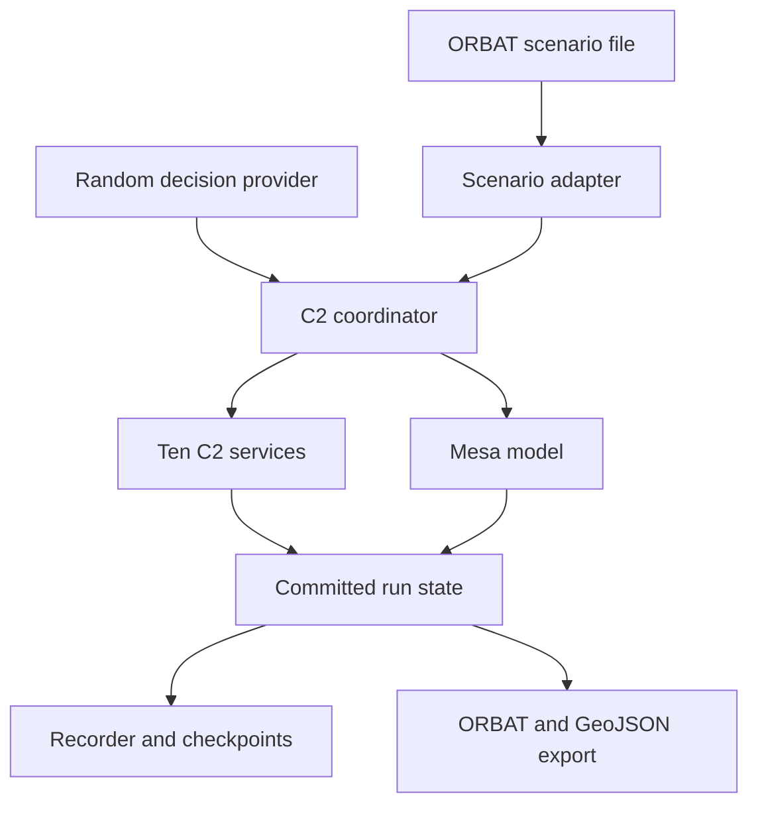

# Mesa C2 State Machine Implementation Plan

Version 2.0 | 11 October 2026 | Status: proposed implementation

## 1. Purpose

This plan defines a concrete implementation of the joint tactical C2 state machine described in:

- [Joint Tactical C2 System — Design and Operation Guide](joint-tactical-c2-design-and-operation-guide.md)
- [Mesa and ORBAT Mapper Simulation Framework](mesa-orbat-mapper-framework-documentation.md)

Mesa is the execution engine. ORBAT Mapper is an unchanged scenario authoring and visualization application.

ORBAT Mapper is used as distributed. The project does not fork it, extend it, embed components in it, or add a live connector to it. The C2 runtime only imports and exports formats that ORBAT Mapper already supports.

The application has no plugin system. The ten C2 services and required Mesa behaviors are fixed modules registered in the application code.

The application has no commander interface. Commander decision logic is outside the system boundary. An abstract decision port accepts requested state transitions. The commander role is to align services by selecting the next valid state for the mission and affected task state machines.

## 2. First implementation outcome

Deliver a headless application that executes the coastal resupply example from the operational guide.

The application must:

- Import a normal ORBAT Mapper scenario file.
- Normalize units, hierarchy, positions, resources, and routes.
- Initialize one deterministic Mesa run.
- Execute the ten C2 services in one process.
- Generate currently valid transition options and pass them through a polymorphic decision interface.
- Use the seeded random decision provider as the only decision implementation.
- Validate every requested transition against explicit guards.
- Advance unit activities, communications, reports, and resources in Mesa.
- Record commands, state changes, reports, evidence, and checkpoints.
- Export runtime states as ORBAT Mapper scenario files and GeoJSON files.
- Complete the example, including a blocked route and a revised plan.

Use Python 3.12, Mesa 3.5.1, FastAPI, Pydantic 2, SQLAlchemy 2, Alembic, pyproj, and SQLite in WAL mode. Run one backend worker and one authoritative simulation process.

Use a fixed simulation interval of 1000 milliseconds. Use separate deterministic seeds for Mesa and the decision provider. Use stable ordering and pin all dependencies.

## 3. Architecture



ORBAT Mapper remains outside the runtime. It creates the initial scenario file and opens exported result files.

The coordinator is the only state writer. It serializes decisions, scheduled messages, Mesa steps, service changes, and persistence operations.

The C2 services own mission, plan, task, force, report, and mobility records. Mesa owns simulated movement, activity progress, actual resources, and physical conditions.

The coordinator generates valid transition options from the registered state machines and current evidence. The decision provider selects one option. It cannot write records directly. The coordinator rechecks the selected option and either commits the complete transition set or rejects it.

## 4. ORBAT Mapper use without modification

Use ORBAT Mapper through its existing import and export functions.

The input workflow is:

1. Create the order of battle, symbols, hierarchy, initial positions, routes, and map features in ORBAT Mapper.
2. Export the scenario as an ORBAT Mapper scenario file.
3. Submit that file to the C2 runtime.
4. Retain the original file and its hash as run provenance.
5. Convert it into the normalized scenario model before creating Mesa agents.

The output workflow is:

1. Export selected committed states as ORBAT Mapper scenario files containing timed unit states.
2. Export tracks, observations, and simple runtime geometry as GeoJSON where suitable.
3. Open or import those files with the normal ORBAT Mapper import dialog.
4. Store C2 decisions, task records, reports, and evidence in a JSON sidecar because ORBAT Mapper does not represent the full workflow.

The runtime can serve generated files at stable URLs because the standard import dialog supports URL sources. ORBAT Mapper does not poll those URLs. A user imports a later file when another view is required.

Preserve stable ORBAT unit identifiers. Record every ignored or unmapped source field. Select the source state at the declared scenario start time and reject ambiguous initial states.

Use a projected coordinate system in metres for simulation calculations. Convert output to WGS 84 longitude and latitude with `always_xy=True`. Validate coordinate round trips and reject positions outside the declared simulation area.

This file exchange is the complete ORBAT integration. There is no ORBAT source modification, custom panel, browser store, embedded control, streaming bridge, or ORBAT-specific plugin.

## 5. Decision-provider contract

The coordinator is responsible for finding possible transitions. The decision provider is responsible only for choosing one of them.

Before every choice, the coordinator evaluates the transition registries and their guards against the latest committed state. It creates one immutable `DecisionInput`. Each `DecisionOption` represents a complete, atomic way to align the affected state machines.

An option can contain one intent, such as moving a mission from `ORGANIZING` to `REVIEWING_SITUATION`. It can also contain several linked intents, such as moving the mission to `PLANNING_TASKS`, preserving unaffected tasks, and assigning an explicit disposition to a blocked task.

Use these exact domain signatures:

```python
from dataclasses import dataclass
from typing import Protocol

@dataclass(frozen=True)
class MachineState:
    machine_type: str
    machine_id: str
    current_state: str
    revision: int

@dataclass(frozen=True)
class TransitionIntent:
    machine_type: str
    machine_id: str
    expected_revision: int
    from_state: str
    target_state: str

@dataclass(frozen=True)
class DecisionOption:
    option_id: str
    intents: tuple[TransitionIntent, ...]
    evidence_ids: tuple[str, ...]

@dataclass(frozen=True)
class DecisionInput:
    decision_id: str
    run_id: str
    commit_seq: int
    simulation_time_ms: int
    machines: tuple[MachineState, ...]
    options: tuple[DecisionOption, ...]

@dataclass(frozen=True)
class DecisionOutput:
    decision_id: str
    provider_id: str
    provider_version: str
    selected_option_id: str
    random_draw_index: int

class DecisionProvider(Protocol):
    @property
    def provider_id(self) -> str:
        ...

    @property
    def provider_version(self) -> str:
        ...

    def choose(self, decision: DecisionInput) -> DecisionOutput:
        ...
```

The input fields have these meanings:

- `decision_id` uniquely identifies one choice.
- `run_id` identifies the authoritative run.
- `commit_seq` identifies the committed state used to construct the choice.
- `simulation_time_ms` is the simulated time of that state.
- `machines` contains the current state and revision of every machine affected by at least one option.
- `options` contains all command-level alignment choices whose guards pass at input creation time.
- `option_id` is stable within the decision and is derived from canonical intent content.
- `evidence_ids` identifies the reports, approvals, or conditions that made the option valid.

The output selects exactly one input option. It does not repeat or modify transition intents. The coordinator rejects an output when the decision ID does not match, the provider identity is unexpected, or the selected option ID is absent from the input.

The coordinator then rechecks every intent against the latest revision and guards. It commits all intents in the selected option atomically. If state changed after input creation, the selection is rejected as stale and a new input is generated.

The coordinator never calls the provider with zero options. A nonterminal machine with no valid option produces a `DecisionStalled` event containing its failed guards. Terminal machines do not request decisions.

### 5.1 Random decision provider

Implement only `RandomDecisionProvider` in the first release. The polymorphic interface makes replacement possible later, but this plan includes no other provider implementation and no provider-loading mechanism.

```python
import random

class RandomDecisionProvider:
    provider_id = "random"
    provider_version = "1.0.0"

    def __init__(self, seed: int) -> None:
        self._rng = random.Random(seed)

    def choose(self, decision: DecisionInput) -> DecisionOutput:
        if not decision.options:
            raise ValueError("DecisionInput.options cannot be empty")

        options = tuple(
            sorted(decision.options, key=lambda option: option.option_id)
        )
        selected_index = self._rng.randrange(len(options))

        return DecisionOutput(
            decision_id=decision.decision_id,
            provider_id=self.provider_id,
            provider_version=self.provider_version,
            selected_option_id=options[selected_index].option_id,
            random_draw_index=selected_index,
        )
```

The chooser uses a uniform discrete selection over all currently valid options. It uses no weights, priorities, mission goals, heuristics, look-ahead, report interpretation, or state preference.

Sort options by `option_id` before drawing so the same seed and input history produce the same selection stream. Store the decision seed, provider version, complete input, complete output, and random generator state in run provenance and checkpoints.

Random choice does not weaken transition safety. The provider can choose only options that already passed guard evaluation, and the coordinator rechecks them before commit. Randomness affects which permitted state is selected, not whether an invalid transition is allowed.

Acknowledgement, acceptance, block, and completion transitions remain evidence-driven and do not call the provider. The provider is called only when more than one command-level direction can be selected or when the workflow requires an explicit command-level transition. When there is one valid option, the same method selects that option.

## 6. Ten fixed C2 services

### 6.1 Mission Control

Owns mission state, objectives, completion criteria, approved-plan reference, authorizations, decision points, and transition history. It validates transition requests but does not select the next state.

### 6.2 Force Organization

Owns force assignments, command relationships, roles, reported readiness, commitments, and resource reservations. It imports the initial organization from the ORBAT file.

### 6.3 Position Tracking

Owns delivered friendly position reports, observation and receipt times, accuracy, and stale status. It never substitutes current Mesa truth for a delivered report.

### 6.4 Tactical Reporting

Owns observation, incident, contact, task-result, and correction reports. It retains conflicting reports and their provenance.

### 6.5 Terrain and Mobility

Owns known routes, crossings, obstacles, restrictions, validity periods, and supporting reports. Known conditions remain separate from actual simulated conditions.

### 6.6 Task Planning

Owns immutable plan versions, task specifications, dependencies, contingencies, and validation results. An approved plan is never edited in place.

### 6.7 Intelligence Tasking

Owns information requirements, collection tasks, priorities, deadlines, and delivered findings. A linked air, maritime, or land task remains owned by its domain service.

### 6.8 Air Force Tasking

Owns air-task records and reported lifecycles. It connects accepted tasks to fixed Mesa air activities.

### 6.9 Navy Tasking

Owns maritime-task records and reported lifecycles. It connects accepted tasks to fixed Mesa maritime activities.

### 6.10 Army Tasking

Owns land-task records and reported lifecycles. It connects accepted tasks to fixed movement, engineering, transfer, and delivery activities.

Services 7 through 10 share one task-lifecycle implementation with fixed domain policies. There is no dynamic service discovery, manifest loading, entry-point loading, or third-party behavior registration.

## 7. State machines

### 7.1 Run state

The coordinator owns `READY`, `RUNNING`, `PAUSED`, `COMPLETED`, `STOPPED`, and `FAILED`.

A run pause freezes time, motion, communication delivery, resource use, and simulated deadlines. Terminal runs cannot resume.

### 7.2 Mission state

Implement these transitions:

- `ORGANIZING → REVIEWING_SITUATION` after force assignments and mission criteria exist.
- `REVIEWING_SITUATION → PLANNING_TASKS` after the planning basis and accepted information gaps are recorded.
- `PLANNING_TASKS → DISPATCHING_DOMAIN_TASKS` after an exact plan version passes validation and is approved.
- `DISPATCHING_DOMAIN_TASKS → EXECUTING` after required initial tasks are accepted and execution is authorized.
- `EXECUTING → COMMANDER_REVIEW` when a decision point requires alignment.
- `COMMANDER_REVIEW → EXECUTING` when continuation is selected and guards pass.
- `COMMANDER_REVIEW → PLANNING_TASKS` when replanning is selected.
- `COMMANDER_REVIEW → REVIEWING_SITUATION` when more information is selected.
- `EXECUTING` or `COMMANDER_REVIEW → PAUSED` when a mission pause is selected.
- `PAUSED → EXECUTING` when continuation is authorized.
- `PAUSED → PLANNING_TASKS` when replanning is selected.
- `COMMANDER_REVIEW → COMPLETED` when all completion criteria have evidence.
- Any nonterminal mission state can transition to `CANCELLED`.

`COMPLETED` and `CANCELLED` are terminal mission states. Reports and task-disposition confirmations can still arrive afterward.

### 7.3 Task state

All tasking services use:

`DRAFT → ISSUED → ACKNOWLEDGED → ACCEPTED → IN_PROGRESS → COMPLETED`

A task can enter `BLOCKED` after acknowledgement, acceptance, or execution. When the block clears, it returns to its last applicable state after guard evaluation.

A nonterminal task can enter `FAILED`. It enters `CANCELLED` only after cancellation takes effect or withdrawal before delivery is proven.

Pause is a disposition, not a task state. An activity can remain `IN_PROGRESS` while its pause instruction is in transit.

A material task change creates a new version and requires new acknowledgement and acceptance. Old-version reports remain in history but cannot advance the new version.

### 7.4 Service alignment

Mission state does not overwrite task state. Entering review does not stop active tasks. Entering planning does not cancel tasks from the previous plan.

When a new plan is approved:

- Unchanged task versions keep their progress and authorization.
- Changed tasks receive new versions.
- Added tasks begin in `DRAFT`.
- Removed tasks receive an explicit continuation, pause, completion, or cancellation disposition.
- Resource reservations transfer only after the old activity stops or a declared handover permits transfer.

These rules let a selected decision option align the services without directly mutating their internal records.

## 8. Records and guards

Persist stable identifiers for runs, missions, plans, tasks, units, reports, commands, decisions, and events.

Keep immutable content versions separate from concurrency revisions. Plan and task versions identify issued content. Mission, task, and run-control revisions prevent stale decisions.

Persist at least:

- Mission objectives, criteria, state, revision, approvals, and authorization scope.
- Immutable plans and task dependency graphs.
- Immutable task versions and separate task execution records.
- Unit execution state, installed task version, position, resources, and last instruction.
- Reports with observation, send, and delivery times.
- Decisions, guard results, reasons, and evidence references.
- Pause and cancellation requests with requested and effective times.
- Reservations and unique supply-transfer identifiers.
- Ordered boundary commits and complete checkpoints.

Represent criteria and dependencies with a small validated predicate language. Initial operators are `all_of`, `any_of`, `task_completed`, `report_confirmed`, `supply_received`, and `element_accounted_for`. Scenario files cannot contain executable expressions.

Use pure guard functions. Guard evaluation returns allowed or rejected status, stable reason codes, and evidence references. State application is a separate coordinator operation.

Reject duplicate identifiers, missing parents, hierarchy cycles, dependency cycles, invalid coordinates, negative resources, unknown states, stale revisions, missing evidence, and incompatible task versions before mutation.

## 9. Mesa execution pipeline

Implement `C2SimulationModel` as a `mesa.Model` and physical units as `UnitAgent` instances. Organizational nodes without physical behavior remain domain records.

Use fixed behaviors for route movement, waiting, inspection, collection, loading, unloading, resource consumption, position reporting, and fixed-delay communications.

For each interval starting at simulated time `T`:

1. Admit decisions and commands assigned to `T`.
2. Deliver instructions and reports due at or before `T`.
3. Update the ten services from delivered evidence.
4. Build a `DecisionInput`, call `DecisionProvider.choose()`, and recheck the selected option when a command-level choice is required.
5. Evaluate task authority, dependencies, pauses, cancellations, and resources.
6. Let agents propose movement, activity, and resource effects.
7. Resolve proposals in stable order.
8. Generate observations and schedule later reports.
9. Persist the candidate boundary and checkpoint in one transaction.
10. Make the committed state available to queries and exports.

Admission, instruction delivery, acknowledgement, acceptance, actual start, reported start, actual completion, and reported completion are separate events.

Messages created in an interval cannot be delivered before the next delivery phase, even with zero configured delay. Queue entries contain serializable data, never callback closures.

Planning decisions can commit in `READY` or run `PAUSED` without advancing time. These control-only commits do not move agents, deliver messages, age reports, or consume resources.

## 10. Machine-oriented API

No human-facing commander application is included.

Run creation accepts the ORBAT scenario file and this configuration:

```python
from typing import Literal
from pydantic import BaseModel, Field

class RandomProviderConfig(BaseModel):
    type: Literal["random"]
    seed: int

class RunCreateInput(BaseModel):
    scenario_start_utc: str
    mesa_seed: int
    dt_ms: int = Field(gt=0)
    decision_provider: RandomProviderConfig

class RunCreateOutput(BaseModel):
    run_id: str
    lifecycle: Literal["READY"]
    control_revision: int
    scenario_hash: str
    provider_id: str
    provider_version: str
```

`RandomProviderConfig` is the only accepted provider configuration in this release. The application composition root constructs `RandomDecisionProvider` and injects it into the coordinator through the `DecisionProvider` protocol.

Expose these machine operations:

- `POST /api/v1/runs` accepts the scenario file and `RunCreateInput`; it returns `RunCreateOutput`.
- `GET /api/v1/runs/{run_id}` returns lifecycle, control revision, commit sequence, and simulated time.
- `POST /api/v1/runs/{run_id}/controls` accepts start, step, pause, resume, or stop with the expected control revision.
- `GET /api/v1/runs/{run_id}/decisions/current` returns the exact `DecisionInput`, or HTTP 204 when no command-level decision is pending.
- `POST /api/v1/runs/{run_id}/decisions/choose` asks the configured provider to select from the current input.
- `GET /api/v1/runs/{run_id}/decisions/{decision_id}` returns the stored input, provider output, applied intents, and final outcome.
- `GET /api/v1/runs/{run_id}/state` returns the committed run, mission, task, unit, and report state.
- `POST /api/v1/runs/{run_id}/exports` creates an ORBAT scenario, GeoJSON, and C2-evidence export.
- `POST /api/v1/runs/{run_id}/restores` creates a child run from a compatible checkpoint.

The choose endpoint accepts and returns:

```python
class DecisionChooseInput(BaseModel):
    decision_id: str
    expected_commit_seq: int

class DecisionAppliedOutput(BaseModel):
    decision: DecisionOutput
    applied_intents: tuple[TransitionIntent, ...]
    outcome: Literal["APPLIED", "STALE", "REJECTED"]
    resulting_commit_seq: int | None
```

The caller cannot provide an option ID. Calling the endpoint invokes the random provider. Continuous execution invokes the same coordinator operation automatically whenever a decision is pending.

Persist `DecisionInput`, `DecisionOutput`, guard recheck results, and applied intents before acknowledging the completed choice.

An identical choose retry returns the stored outcome without drawing again. A mismatched decision ID or commit sequence is rejected as stale. A second request for an already resolved decision cannot consume another random draw.

Use a configured system identity for the initial headless implementation and retain it in the audit record. Authentication and a human command application are separate concerns.

## 11. Persistence and recovery

Use SQLAlchemy repositories and SQLite with foreign keys, WAL mode, and a bounded busy timeout. Use one writer and refuse a second writer for the same database.

Persist a decision and its outcome in the same transaction as its state effects. This prevents an acknowledged decision from being lost or applied twice.

For the initial implementation, create a complete checkpoint at every committed boundary. Include service records, agents, task versions, messages, pending decisions, resources, counters, and random-generator states.

Do not publish candidate state before the database commit succeeds. On execution failure, discard the candidate and restore the last commit.

A restored execution receives a new run identifier and keeps its parent run and checkpoint references. Recorded playback reads retained states without running Mesa. Deterministic re-execution rebuilds the model and consumes the recorded decisions and inputs.

## 12. Demonstration scenario

Create `scenarios/coastal-resupply/` with:

- The unchanged source ORBAT Mapper scenario.
- A normalized simulation scenario.
- C2 objectives, criteria, tasks, dependencies, and timings.
- A random-provider configuration containing the decision seed.
- Expected milestones and invariants.

Use `HQ-1`, `INT-1`, `AIR-REC-1`, `AIR-LIFT-1`, `SEA-1`, `ENG-1`, `GROUND-1`, and `POST-1`.

At every command-level decision point, the coordinator enumerates the currently valid options and `RandomDecisionProvider` selects one uniformly. The selected option can continue execution, request more information, pause, replan, complete, or cancel when those transitions are valid.

Because the chooser has no goal or preference, different seeds can produce different mission paths and terminal states. Cancellation, repeated review, and inefficient replanning are valid random outcomes. Safety invariants must hold for every seed.

After implementation, choose and record one reference seed whose unmodified random stream exercises the intended resupply path:

1. Move from organization through situation review and planning.
2. Authorize preliminary collection.
3. Approve, dispatch, and execute main plan version 1.
4. Receive the unavailable-crossing report and enter review.
5. Randomly select replanning rather than cancellation or continuation.
6. Approve version 2 while preserving unaffected tasks.
7. Resume execution and deliver fifty supply units.
8. Randomly select completion when its guards become true.
9. Export the final ORBAT scenario, GeoJSON overlays, C2 sidecar, decision inputs, outputs, and random-provider state.

The reference seed is a reproducible demonstration fixture, not a decision rule. Do not alter available options, add weights, redraw an inconvenient selection, or search for a preferred option during a run. A separate offline fixture-generation step may identify the reference seed and then freeze it in the scenario package.

## 13. Repository structure

```text
backend/
  src/c2sim/
    api/
    contracts/
    domain/
    services/
    runtime/
    simulation/
    persistence/
    orbat_io/
    decisions/
  migrations/
schemas/
scenarios/
  coastal-resupply/
tests/
deploy/
```

Domain code must not import FastAPI, SQLAlchemy, or ORBAT parsing details. The `orbat_io` package converts standard files at the boundary. The `decisions` package contains the provider protocol, decision data types, and the single random implementation.

## 14. Implementation phases

### Phase 1 — Contracts and ORBAT file conversion

Create the skeleton, locks, enums, records, transition intents, and normalized scenario schema. Implement ORBAT import and timed-state plus GeoJSON export.

Exit when a round trip preserves unit identity, hierarchy, symbols, resources, and positions within the declared tolerance.

### Phase 2 — Deterministic Mesa runtime

Implement the coordinator, run lifecycle, fixed clock, agents, fixed behaviors, scheduled-message queue, transaction, checkpoint, and restore path.

Exit when a headless fixture reproduces the same state from the same inputs and continues consistently from a checkpoint.

### Phase 3 — C2 services and state machines

Implement the ten services, transition registries, task lifecycle, plan versions, dependency validation, reservations, reports, mobility knowledge, decision-option generator, typed provider contract, seeded `RandomDecisionProvider`, and atomic option handler.

Exit when permitted and rejected transitions behave correctly, input and output contracts validate, the same seed and ordered inputs reproduce the same choices, stale selections fail, and a rejected option leaves no partial change.

### Phase 4 — Complete demonstration

Connect task records to Mesa activities. Implement delayed acknowledgement, acceptance, start, progress, block, completion, pause, and cancellation reports. Add the resupply package, random-provider configuration, and recorded reference seed.

Exit when the crossing causes review, the revision preserves unaffected tasks, fifty supply units arrive exactly once, and completion requires receipt and accountability evidence.

### Phase 5 — Recovery, export, and packaging

Add the API, durable recovery, playback, final exports, containers, persistent storage, logs, and operating documentation.

Exit when a fresh checkout runs the demonstration headlessly, survives process replacement, restores work without duplication, and produces files accepted by unchanged ORBAT Mapper.

## 15. Acceptance criteria

- `DecisionInput` contains only options whose guards pass against its stated commit sequence.
- `RandomDecisionProvider` selects only from the supplied options and uses no scoring or weighting.
- The same decision seed and ordered input sequence reproduce the same outputs.
- Decision input, selected index, selected option, provider version, and generator state survive checkpoint and restore.
- A repeated choose request returns the stored output and consumes no new random draw.
- Duplicate decisions and commands produce one effect.
- Competing decisions using one expected revision cannot both succeed.
- Invalid target states fail before mutation.
- Dependency cycles are identified and rejected.
- Tasks cannot start without the accepted version and authority.
- Preliminary collection can run during situation review.
- The decision context contains delivered information rather than hidden truth.
- An unavailable crossing constrains movement before its report arrives.
- Older reports remain in history without replacing newer reports.
- Material task changes require new acknowledgement and acceptance.
- Unchanged task versions keep progress across replanning.
- Mission pause prevents new starts while active dispositions remain explicit.
- Run pause freezes time and delivery.
- Late cancellation cannot erase completed activity.
- Mission completion fails without receipt or accountability evidence.
- Failure cannot retain or publish a partial interval.
- Restore preserves messages, authority, resources, versions, and randomness.
- ORBAT exports preserve stable identifiers and the original source file.
- The demonstration requires no ORBAT modification and no commander interface.

## 16. Definition of done

The work is complete when the headless runtime imports a standard ORBAT Mapper scenario, executes the resupply mission through all ten services, generates valid alignment options, selects among them through the polymorphic provider interface, preserves deterministic and recoverable Mesa state, and exports results that standard ORBAT Mapper can open.

The only provider implementation is the seeded `RandomDecisionProvider`. It chooses uniformly and has no embedded commander reasoning. The coordinator enforces state-machine rules. Mesa determines simulated effects. ORBAT Mapper remains an unchanged file-based authoring and visualization tool.

## References

- [ORBAT Mapper import documentation](https://github.com/orbat-mapper/orbat-mapper/blob/main/user-docs/guide/import-data.md)
- [ORBAT Mapper export documentation](https://github.com/orbat-mapper/orbat-mapper/blob/main/user-docs/guide/export-data.md)
- [Mesa 3.5.1 release](https://github.com/mesa/mesa/releases/tag/v3.5.1)
- [Mesa Model API](https://mesa.readthedocs.io/stable/apis/model.html)
