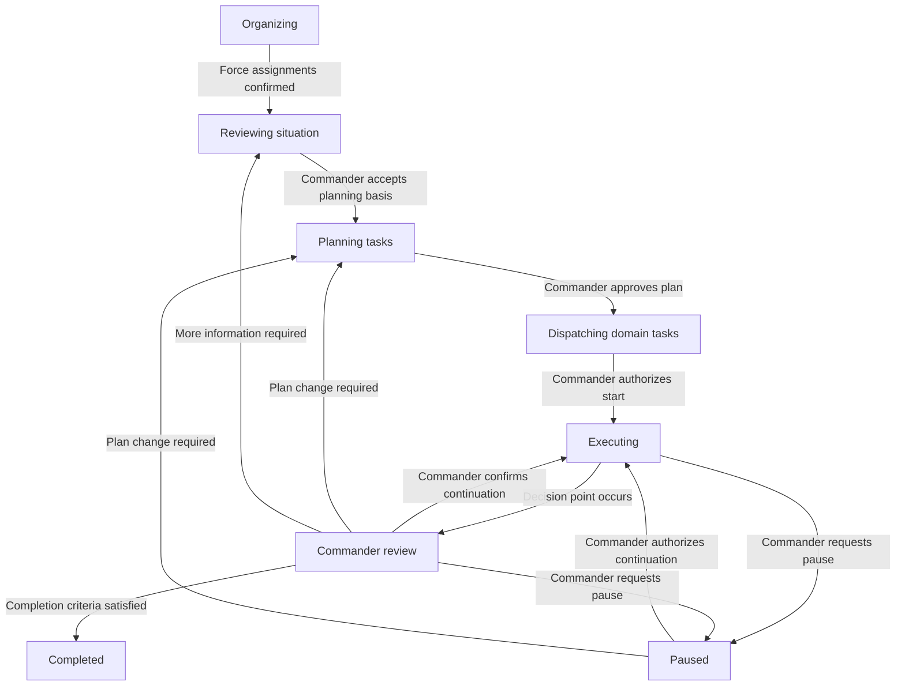

# Joint Tactical C2 System — Design and Operation Guide

*This draft uses ASD-STE100 writing principles and defined technical terms. A full check against the approved dictionary remains necessary.* ASD-STE100 includes writing rules and a controlled dictionary. [Source: ASD-STE100](https://www.asd-ste100.org/about_STE.html).

## 1. Purpose

The system helps a commander control a joint tactical mission.

The system contains ten services. Each service has a defined responsibility. Mission Control connects these services through a mission state machine.

The commander uses the system to:

- Establish mission objectives.
- Check available forces.
- Examine the situation.
- Approve a plan.
- Issue tasks.
- Examine task progress.
- Change the plan.
- Confirm mission completion.

The example mission supplies an isolated friendly position. Air, maritime, and land elements support the mission. Intelligence personnel provide information for command decisions.

## 2. Terms

The terms below have the same meaning throughout this guide.

| Term | Definition |
|---|---|
| **Service** | A software component with a defined responsibility and interface. |
| **Mission** | An operation with objectives, assigned forces, constraints, and completion criteria. |
| **Mission state** | The current phase of the command workflow. |
| **State machine** | A set of states and rules for movement between states. |
| **Transition** | A change from one state to another state. |
| **Guard condition** | A condition that must be true before a transition can occur. |
| **Command** | A request for the system to perform an action. |
| **Event** | A record of an action or change that occurred. |
| **Plan version** | An identified revision of a mission plan. |
| **Task** | An assignment with an owner, required result, and completion criteria. |
| **Task dependency** | A condition that another task must satisfy before a task can start. |
| **Acknowledgement** | Confirmation that the assigned element received a task. |
| **Acceptance** | Confirmation that the assigned element can perform a task. |
| **Report** | Information from a person, unit, sensor, or external system. |
| **Decision point** | A condition that requires a commander decision. |

## 3. System Design

### 3.1 Responsibility for state

Mission Control owns the mission state.

Each tasking service owns the state of its tasks.

A mission state and a task state describe different conditions. For example, the mission can enter Commander Review while an aircraft continues an accepted task.

A change to the mission state does not automatically stop active tasks.

### 3.2 Responsibility for decisions

The commander approves plans and mission transitions.

Assigned elements acknowledge tasks and report acceptance.

Services check conditions and present information. Services do not approve their own plans.

The toy system uses one commander role. The design can later include explicit delegation of command authority.

### 3.3 Continuous updates

Position Tracking and Tactical Reporting receive updates in all mission states.

Tasking services also receive progress reports in all mission states.

Completed and cancelled missions remain available for examination. New reports can enter the record without reopening the mission.

### 3.4 Service interfaces

Each service provides an interface for commands and queries.

Each service publishes events after changes to its records.

A shared interface displays information from the ten services. The interface does not own mission or task state.

## 4. Service Definitions

### 4.1 Service 1 — Mission Control

**Purpose**

Mission Control owns the mission state, objectives, deadlines, and approval history.

**Records**

The service stores:

- Mission identifier.
- Commander identifier.
- Objectives and completion criteria.
- Constraints and deadlines.
- Current mission state.
- Approved plan version.
- Decisions and transition history.

**Operation**

The service checks each requested transition against its guard conditions.

If a condition is not satisfied, the service rejects the transition. The response identifies the condition that prevented the change.

The service examines task progress against mission completion criteria. It presents decision points to the commander.

**Commander actions**

1. Create the mission.
2. Enter the objectives.
3. Enter the completion criteria.
4. Enter the constraints.
5. Approve the required transitions.

**Outputs**

The service publishes mission state changes and commander decisions.

### 4.2 Service 2 — Force Organization

**Purpose**

Force Organization maintains assigned units, command relationships, personnel availability, and vehicle readiness.

**Records**

The service stores:

- Unit identifiers.
- Parent units and command relationships.
- Mission attachments.
- Personnel availability.
- Equipment availability.
- Vehicle readiness.
- Assigned roles.
- Current commitments.

**Operation**

The service supplies availability information to Task Planning.

The service identifies conflicts between proposed assignments and current commitments. The commander can resolve each conflict before plan approval.

An available unit does not automatically have permission to perform a task.

**Commander actions**

1. Select the assigned units.
2. Establish command relationships.
3. Designate lead elements.
4. Assign a reserve.
5. Examine readiness deficiencies.

**Outputs**

The service publishes changes to force assignments, availability, and readiness.

### 4.3 Service 3 — Position Tracking

**Purpose**

Position Tracking tracks friendly positions, movement, last update time, and progress through checkpoints.

**Records**

Each position record contains:

- Unit identifier.
- Position.
- Observation time.
- Receipt time.
- Source identifier.
- Reported position accuracy.
- Related mission and task identifiers.

**Operation**

The service maintains the latest valid position for each friendly unit.

The service retains earlier positions for later examination. An older report does not replace a newer observation.

The display shows the age of each position.

If a position exceeds the configured age limit, the service marks the position as stale. The last known position remains visible.

**Commander actions**

1. Examine unit positions.
2. Examine checkpoint progress.
3. Identify separated elements.
4. Request updates for stale positions.

**Outputs**

The service publishes position updates, checkpoint arrivals, and stale-position alerts.

### 4.4 Service 4 — Tactical Reporting

**Purpose**

Tactical Reporting combines observation, contact, incident, and unit status reports into a shared situation picture.

**Records**

Each report contains:

- Report identifier.
- Source identifier.
- Observation time.
- Receipt time.
- Location, if available.
- Report type.
- Report content.
- Confirmation status.
- Related units, tasks, and missions.

**Operation**

The service connects related reports.

The service retains the original report content. A corrected report refers to the original report.

If reports disagree, the service displays the disagreement. It does not remove the disagreement through an automatic assumption.

A report does not become confirmed only because the system received it.

**Commander actions**

1. Examine new reports.
2. Examine conflicting reports.
3. Request clarification.
4. Record confirmation status.
5. Identify information gaps.

**Outputs**

The service publishes new reports, report corrections, and changes to confirmation status.

### 4.5 Service 5 — Terrain and Mobility

**Purpose**

Terrain and Mobility maintains routes, crossings, obstacles, weather effects, and reported access restrictions.

**Records**

The service stores:

- Routes and movement areas.
- Checkpoints and crossings.
- Reported obstacles.
- Access restrictions.
- Relevant weather conditions.
- Source and observation time.
- Validity period, if available.

**Operation**

The service provides movement constraints to Task Planning.

The service distinguishes confirmed conditions from unconfirmed conditions.

A route remains subject to the age and quality of its supporting information. A displayed route does not establish that movement is possible.

**Commander actions**

1. Examine proposed routes.
2. Examine reported restrictions.
3. Identify uncertain access conditions.
4. Request engineering checks through Army Tasking.

**Outputs**

The service publishes changes to routes, obstacles, crossings, and access conditions.

### 4.6 Service 6 — Task Planning

**Purpose**

Task Planning builds short-horizon plans with unit assignments, dependencies, timings, and contingencies.

**Records**

Each plan version contains:

- Plan identifier and version.
- Mission identifier.
- Proposed tasks.
- Assigned elements.
- Required resources.
- Start conditions.
- Task dependencies.
- Planned times.
- Contingencies.
- Approval status.

**Operation**

The service uses information from services 2 through 5.

The service checks resource conflicts and task dependencies.

A task cannot depend on itself. A dependency chain cannot return to its starting task.

An approved plan version remains unchanged. A plan change creates a new version.

**Commander actions**

1. Examine candidate plans.
2. Examine assumptions.
3. Resolve resource conflicts.
4. Change task assignments.
5. Approve a plan version.

**Outputs**

The service publishes proposed plans and records approved plan versions.

### 4.7 Service 7 — Intelligence Tasking

**Purpose**

Intelligence Tasking converts information requirements into collection tasks.

**Records**

Each task identifies:

- The information requirement.
- The area or subject of interest.
- The required result.
- The assigned intelligence element.
- The priority.
- The delivery deadline.
- The task state.
- Related reports.

**Operation**

The service tracks task acceptance, collection progress, and delivery of findings.

The service connects each result to its information requirement.

The commander can receive a result that remains uncertain. Task completion does not automatically confirm the result.

If collection requires an air, maritime, or land asset, Task Planning creates the related domain task.

Intelligence Tasking does not independently assign assets owned by another domain.

**Commander actions**

1. Define the information requirement.
2. Set its priority.
3. Specify the required delivery time.
4. Approve the collection task.
5. Examine the delivered findings.

**Outputs**

The service publishes task progress and findings for Tactical Reporting.

### 4.8 Service 8 — Air Force Tasking

**Purpose**

Air Force Tasking assigns tasks to available air elements.

**Records**

Each task identifies:

- Assigned air element.
- Required activity.
- Required load or support.
- Relevant locations.
- Planned time.
- Start conditions.
- Task dependencies.
- Required result.
- Task state.

**Operation**

The service tracks acknowledgement, readiness, acceptance, execution, and completion.

The service obtains unit availability from Force Organization.

A task can cover aerial reconnaissance, airlift, transport, or evacuation support.

The assigned element reports restrictions that affect acceptance or execution.

**Commander actions**

1. Select the required air support.
2. Examine asset availability.
3. Approve the assignment.
4. Examine acceptance and progress.
5. Approve task changes.

**Outputs**

The service publishes acceptance decisions, progress reports, and completion reports.

### 4.9 Service 9 — Navy Tasking

**Purpose**

Navy Tasking assigns tasks to available maritime elements.

**Records**

Each task identifies:

- Assigned maritime element.
- Required activity.
- Required load or support.
- Departure and arrival locations.
- Planned time.
- Start conditions.
- Task dependencies.
- Required result.
- Task state.

**Operation**

The service tracks acknowledgement, readiness, acceptance, execution, and completion.

The service obtains unit availability from Force Organization.

A task can cover maritime surveillance, sea transport, escort, or recovery support.

The assigned element reports access conditions and support requirements.

**Commander actions**

1. Select the required maritime support.
2. Examine asset availability.
3. Approve the assignment.
4. Examine acceptance and progress.
5. Approve task changes.

**Outputs**

The service publishes acceptance decisions, progress reports, and completion reports.

### 4.10 Service 10 — Army Tasking

**Purpose**

Army Tasking assigns tasks to available land elements.

**Records**

Each task identifies:

- Assigned land element.
- Required activity.
- Required personnel and equipment.
- Relevant locations.
- Planned time.
- Start conditions.
- Task dependencies.
- Required result.
- Task state.

**Operation**

The service tracks acknowledgement, readiness, acceptance, execution, and completion.

The service obtains unit availability from Force Organization.

A task can cover ground movement, engineering, security, resupply, or medical support.

The assigned element reports obstacles, support requirements, and task results.

**Commander actions**

1. Select the required land support.
2. Examine unit availability.
3. Approve the assignment.
4. Examine acceptance and progress.
5. Approve task changes.

**Outputs**

The service publishes acceptance decisions, progress reports, and completion reports.

## 5. Mission State Machine

### 5.1 Main workflow

The mission state identifies the current command phase.

The commander can cancel a mission from any nonterminal state.

Completed and Cancelled are terminal mission states.

### 5.2 State definitions

| State | System behavior | Condition for the next phase |
|---|---|---|
| **Organizing** | Establish objectives, command relationships, force assignments, and readiness records. | The commander confirms the force assignments. |
| **Reviewing situation** | Present positions, reports, terrain conditions, and information gaps. | The commander accepts the information as sufficient for the proposed planning activity. |
| **Planning tasks** | Prepare task assignments, dependencies, and contingencies. | The commander approves an identified plan version. |
| **Dispatching domain tasks** | Issue approved tasks through services 7 through 10. | Required initial tasks are accepted, and the commander authorizes execution. |
| **Executing** | Receive progress reports and identify decision points. | A decision point requires review, or the commander requests a pause. |
| **Commander review** | Present current results, changes, and unresolved conditions. | The commander selects continuation, replanning, further review, pause, or completion. |
| **Paused** | Prevent new task starts and track pause instructions for active tasks. | The commander authorizes continuation or requests a new plan. |
| **Completed** | Retain the mission record and completion evidence. | No further execution transition is permitted. |
| **Cancelled** | Prevent new task starts and track cancellation of active tasks. | No further execution transition is permitted. |

### 5.3 Transition checks

Each transition record contains:

- Mission identifier.
- Previous state.
- Requested state.
- Trigger.
- Commander identifier.
- Decision time.
- Applicable plan version.
- Guard-condition results.
- Reason for the decision.

A rejected transition does not change the mission state.

The system returns the rejection reason to the commander.

### 5.4 Execution authorization

Acceptance of a task does not authorize its immediate start.

A task can start only when:

- The task belongs to the applicable approved plan.
- The assigned element accepted the task.
- Required dependencies are satisfied.
- Required resources remain available.
- The applicable execution authorization exists.
- No pause or cancellation instruction prevents the start.

### 5.5 Pause behavior

Paused describes the command workflow.

Active elements can require time to perform a pause instruction.

The display distinguishes a requested pause from a confirmed pause. The system retains the actual reported state of each task.

The commander can specify which tasks must stop. Support tasks can continue if the commander explicitly permits continuation.

## 6. Task State Machine

Services 7 through 10 use the same task states.

| State | Meaning |
|---|---|
| **Draft** | The task exists but has not been issued. |
| **Issued** | The service released the task to the assigned element. |
| **Acknowledged** | The assigned element confirmed receipt. |
| **Accepted** | The assigned element confirmed its ability to perform the task. |
| **In progress** | The assigned element reported that execution started. |
| **Blocked** | A condition prevents the next required action. |
| **Completed** | A completion report satisfies the task completion criteria. |
| **Failed** | The assigned element cannot achieve the required result. |
| **Cancelled** | Cancellation took effect before task completion. |

The normal sequence is:

**Draft → Issued → Acknowledged → Accepted → In progress → Completed**

A rejected assignment includes a reason. The task enters Failed if the assigned element cannot undertake it.

A task can become Blocked after acknowledgement, acceptance, or execution.

Each blocked-task record identifies:

- The blocking condition.
- The affected action.
- The previous task state.
- The required corrective action.
- The responsible element.
- The time of the report.

When the condition clears, the service checks the start conditions again. The task returns to the applicable state.

A blocked task creates a decision point if it affects a mission objective or a dependent task.

### 6.1 Task changes

A task change identifies the previous task version.

The original task record remains available.

The assigned element must acknowledge the changed version. A material change also requires renewed acceptance.

The system displays which version the element currently executes.

### 6.2 Task cancellation

A cancellation request does not prove that execution stopped.

The service records the request and sends the cancellation instruction.

The task enters Cancelled after confirmation that cancellation took effect. The record includes any partial result.

A task can complete before a delayed cancellation reaches the assigned element. The service retains the actual completion result.

## 7. Information Exchange

### 7.1 Common identifiers

All related records use stable identifiers.

The minimum identifiers are:

- Mission identifier.
- Plan identifier and version.
- Task identifier and version.
- Unit identifier.
- Report identifier.
- Command identifier.
- Event identifier.

A task report identifies the applicable task version.

### 7.2 Commands and events

A command requests an action.

An event records an action that occurred.

For example, `ApprovePlan` is a command. `PlanApproved` is an event.

Mission Control issues commands to the responsible service. The responsible service checks the command before it changes its records.

### 7.3 Record ownership

| Record | Authoritative service |
|---|---|
| Mission state and commander decisions | Mission Control |
| Force assignments and readiness | Force Organization |
| Current friendly positions | Position Tracking |
| Reports and confirmation status | Tactical Reporting |
| Routes and access conditions | Terrain and Mobility |
| Plan versions and task dependencies | Task Planning |
| Intelligence tasks | Intelligence Tasking |
| Air tasks | Air Force Tasking |
| Maritime tasks | Navy Tasking |
| Land tasks | Army Tasking |

Other services can retain copies for display or calculation.

A copy does not replace the authoritative record.

### 7.4 Duplicate and delayed messages

Each service checks the command identifier before it performs an action.

A repeated command returns the previous result. It does not create another task.

Each service also checks event identifiers.

Delayed reports remain available in the history. A delayed report does not automatically reverse a later valid state change.

Observation time and receipt time remain separate.

## 8. Commander Interface

The interface provides five main views.

| View | Displayed information |
|---|---|
| **Mission panel** | Objectives, current state, approved plan, deadlines, and completion criteria. |
| **Situation map** | Friendly positions, report locations, routes, restrictions, and information age. |
| **Force panel** | Assigned elements, command relationships, availability, and readiness. |
| **Task board** | Tasks by domain, task states, dependencies, deadlines, and assigned elements. |
| **Decision queue** | Conditions that require commander action and the supporting evidence. |

Each decision point identifies the affected objective or task.

The commander can open the related reports and plan version.

The interface displays uncertainty and missing information. It does not represent missing information as a confirmed normal condition.

## 9. Example Mission Procedure

**Mission:** Deliver supplies to an isolated coastal position.

**Completion criteria:** Confirm supply receipt and account for assigned elements.

### 9.1 Organize the mission

1. Create the mission in Mission Control.
2. Enter the delivery objective.
3. Enter the completion criteria.
4. Set the mission deadline.
5. Attach available elements through Force Organization.
6. Examine personnel and equipment readiness.
7. Confirm the force assignments.

### 9.2 Examine the situation

1. Open the situation map.
2. Examine friendly positions.
3. Examine position timestamps.
4. Examine current reports.
5. Examine access restrictions.
6. Identify information gaps.
7. Create intelligence requirements for the information gaps.
8. Approve the required collection tasks.
9. Examine the collection results.
10. Accept the planning basis.

Preliminary collection tasks require explicit authorization. They can operate before the main mission enters Executing.

### 9.3 Prepare the plan

1. Create a plan version in Task Planning.
2. Add a maritime transport task.
3. Add an air transport task for time-sensitive supplies.
4. Add an engineering task to examine the transfer route.
5. Add a ground transport task.
6. Connect the ground task to the required delivery and access results.
7. Examine resource conflicts.
8. Examine task dependencies.
9. Establish contingencies.
10. Approve the plan version.

### 9.4 Issue the tasks

1. Release the approved tasks to the applicable tasking services.
2. Examine delivery status.
3. Examine acknowledgements.
4. Examine task acceptance.
5. Resolve rejected assignments.
6. Confirm that required initial tasks can start.
7. Authorize mission execution.

### 9.5 Control execution

1. Examine task progress.
2. Examine unit positions.
3. Examine new reports.
4. Examine blocked tasks.
5. Open decision points that affect mission objectives.

Assume that the engineering element reports an unavailable crossing.

Terrain and Mobility records the restriction.

Army Tasking marks the affected movement task as Blocked.

Task Planning identifies the dependent tasks.

Mission Control presents the effect on the delivery objective.

### 9.6 Change the plan

1. Examine the crossing report.
2. Confirm which tasks the restriction affects.
3. Request additional information if necessary.
4. Enter Planning Tasks.
5. Create a new plan version.
6. Revise the affected assignments.
7. Examine the revised dependencies.
8. Approve the new plan version.
9. Issue the task changes.
10. Confirm acceptance of the changed tasks.
11. Authorize continuation.

Unaffected tasks retain their existing authorization unless the commander changes it.

### 9.7 Complete the mission

1. Examine the supply receipt report.
2. Confirm that the delivery criterion is satisfied.
3. Account for assigned elements.
4. Resolve outstanding task dispositions.
5. Record remaining limitations.
6. Confirm mission completion.

A completed task does not automatically complete the mission.

Mission Control checks all mission completion criteria before it permits the Completed transition.

## 10. Implementation Sequence

### Phase 1 — Establish the records

1. Define the mission record.
2. Define the force record.
3. Define the report record.
4. Define the plan record.
5. Define the common task record.
6. Assign an authoritative service to each record.
7. Define the identifiers and timestamps.

### Phase 2 — Establish the state machines

1. Implement the mission states in Mission Control.
2. Implement the transition guards.
3. Implement the common task states.
4. Implement the task start conditions.
5. Implement pause and cancellation records.
6. Record all decisions and state changes.

### Phase 3 — Connect the services

1. Define command interfaces.
2. Define query interfaces.
3. Define event messages.
4. Implement duplicate-message checks.
5. Connect reports to tasks.
6. Connect tasks to plan versions.
7. Connect plan versions to missions.

### Phase 4 — Build the commander interface

1. Build the mission panel.
2. Build the situation map.
3. Build the force panel.
4. Build the task board.
5. Build the decision queue.
6. Display report sources and timestamps.

### Phase 5 — Verify the toy system

1. Execute the example mission with simulated elements.
2. Repeat a task-issue command.
3. Confirm that the system creates only one task.
4. Submit an older position report.
5. Confirm that the current position remains unchanged.
6. Reject a required task assignment.
7. Confirm that the execution guard prevents the mission start.
8. Block a task with dependent tasks.
9. Confirm that the system identifies the affected dependencies.
10. Request a pause during execution.
11. Confirm that requested and confirmed pauses remain distinct.
12. Restart Mission Control.
13. Confirm that the mission state and approval history remain available.
14. Attempt mission completion with an unmet criterion.
15. Confirm that the system rejects the transition.
