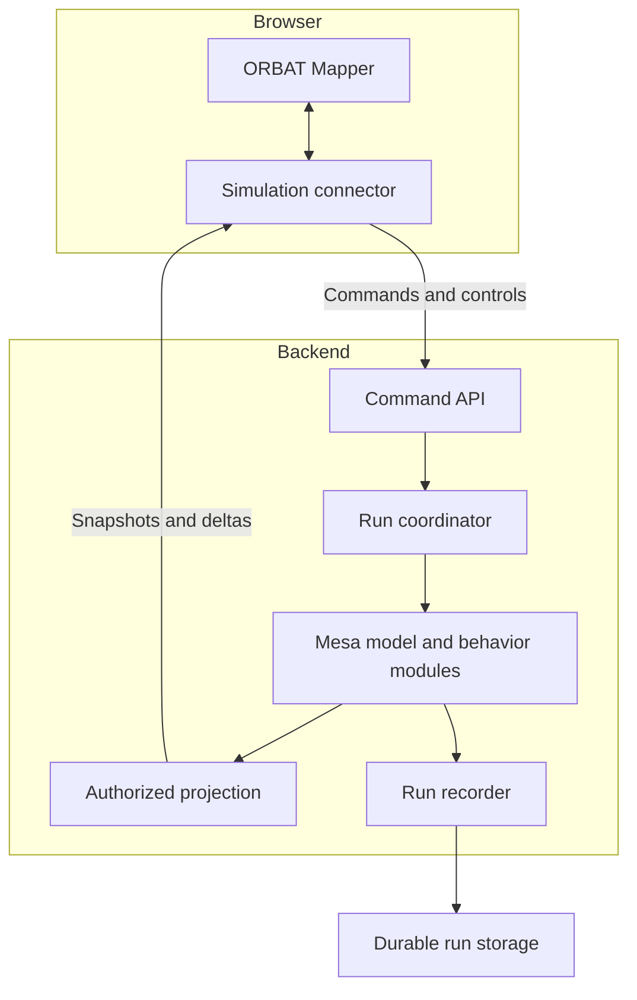

# Mesa and ORBAT Mapper Simulation Framework

Technical reference and implementation guide

Version 1.0   |   11 October 2026

This framework combines a Mesa simulation backend with an adapted ORBAT Mapper interface. Mesa executes entity behavior and maintains the simulated world. ORBAT Mapper provides scenario authoring, the order of battle, military symbology, map interaction, and review of recorded activity. A framework service connects these responsibilities through versioned commands and state projections.

This document defines the framework architecture, operating rules, extension interfaces, and implementation sequence. It is intended for software engineers, simulation developers, researchers, and maintainers. Readers should be able to create a scenario, implement a behavior module, connect the map, run an experiment, and diagnose synchronization problems.

Status and scope. No combined framework repository was supplied. The framework APIs, schemas, package layout, and extension contracts in this document are proposed interfaces to implement. They are not existing Mesa or ORBAT Mapper APIs. Upstream facts are identified with numbered references; framework requirements express the design defined here.

Reference baseline. Mesa 3.5.1 is the selected Python baseline. ORBAT Mapper is an upstream application to adapt and pin to a tested commit. The runnable example demonstrates Mesa behavior only. It does not implement the full run service, transport, persistence, or ORBAT Mapper connector.

The initial implementation should use one authoritative simulation process with internal behavior modules, one API service, and one browser application. This provides replaceable components without introducing independent clocks or distributed state ownership.

# Contents

- [1 Framework responsibilities](#1-framework-responsibilities)
- [2 System architecture](#2-system-architecture)
- [3 Domain model and identity](#3-domain-model-and-identity)
- [4 Scenario packaging and validation](#4-scenario-packaging-and-validation)
- [5 Run lifecycle and operator controls](#5-run-lifecycle-and-operator-controls)
- [6 Simulation clock and execution](#6-simulation-clock-and-execution)
- [7 Mesa agents and behavior modules](#7-mesa-agents-and-behavior-modules)
- [8 Geographic coordinates and display](#8-geographic-coordinates-and-display)
- [9 Command interface](#9-command-interface)
- [10 API and state transport](#10-api-and-state-transport)
- [11 ORBAT Mapper integration](#11-orbat-mapper-integration)
- [12 Extension development](#12-extension-development)
- [13 Working with the framework](#13-working-with-the-framework)
- [14 Recording checkpoints and replay](#14-recording-checkpoints-and-replay)
- [15 Deployment and maintenance](#15-deployment-and-maintenance)
- [16 Validation observability and troubleshooting](#16-validation-observability-and-troubleshooting)
- [17 Implementation sequence](#17-implementation-sequence)
- [Appendix A Runnable Mesa example](#appendix-a-runnable-mesa-example)
- [Appendix B Source references](#appendix-b-source-references)

# 1 Framework responsibilities

## 1.1 What the framework provides

The framework supports repeatable C2 experiments in which entities receive tasks, move through an environment, produce observations, communicate reports, and consume resources. Scenario authors configure the initial world and behavior modules. Operators submit commands through the interface. Researchers examine event histories and collected measurements.

The core supplies entity lifecycle, simulation time, command admission, scheduled delivery, phase execution, state projection, and recording. Behavior modules supply domain rules. A movement module may use direct motion, road routing, or another declared movement model. A communications module may apply configurable delay or loss. The framework does not assign operational fidelity to these rules; each module documents its assumptions and validation evidence.

A Mesa agent is an ordinary simulation object with state and behavior. It need not call a language model. An external reasoning service can be added through the extension boundary described in Chapter 12.

## 1.2 Upstream capabilities and new integration work

Mesa provides Model and Agent classes, agent registration, AgentSet activation, random generators, spatial containers, and data collection. Agents register with their model when their superclass constructor runs. Their internal unique_id is assigned by Mesa. [1, 2]

ORBAT Mapper is a client-side Vue application. Its repository describes a central scenario store with normalized state, timed entity states, and immutable updates with undo and redo. Pinia also holds lightweight interface state. The checked dependency manifest includes MapLibre GL and milsymbol. [3, 4]

The upstream glossary describes a vendor-independent MapAdapter between scenario logic and map rendering. The integration should preserve that separation. The glossary also distinguishes ordinary geometry, doctrinal control measures, and point symbols. [5]

The framework adds a run service, backend behavior registry, scenario conversion, command and observation contracts, a frontend simulation connector, live state projection, and recorded-run export. These additions require implementation in the backend and an ORBAT Mapper fork or maintained integration branch.

## 1.3 Design requirements

Each run must have one writer for authoritative model state. Browser requests and plugins must enter through controlled commands or proposals. Each committed simulation interval must produce a coherent state that the renderer can consume.

Simulation behavior must be independent of map rendering. Closing a browser must not stop a run unless the selected run policy explicitly requires operator presence.

A recorded experiment must identify its input scenario revision, configuration, code versions, random initialization, accepted inputs, and module versions. A map animation alone is insufficient evidence for reproducing a run.

# 2 System architecture

## 2.1 Runtime components

The browser contains ORBAT Mapper and a simulation connector. The connector submits commands, receives snapshots, maintains connection state, and supplies the current projection to the map and unit panels. Scenario authoring remains in the existing application.

The API service validates requests, checks caller permissions, stores command receipts, and forwards accepted operations to the run coordinator. Transport handlers do not directly modify agents.

The run coordinator owns lifecycle transitions and the simulation writer. It invokes Mesa and coordinates behavior phases. It also creates immutable output for projection and recording.

The projection component converts authoritative state into a specified viewer perspective. An instructor can receive a truth projection. A participant can receive friendly state and reports available to the participant's headquarters. Restricted information is removed before serialization.

The recorder stores scenario provenance, accepted inputs, committed results, and checkpoints. It receives committed output rather than querying agents while they are changing.



Figure 1. Proposed runtime components and information flow. Commands enter through the API and coordinator. Committed output feeds both projection and recording. The browser receives an authorized projection.

## 2.2 Deployment boundary

These components are logical modules. The first release can host the coordinator, Mesa model, projection, and recorder in one backend process. It does not need one microservice for every behavior.

A process boundary is appropriate when a module needs another language, separate dependency management, independent capacity, or failure isolation. An external module still uses the run coordinator's simulation time and versioned input contracts.

## 2.3 Ownership rules

The scenario author owns baseline content before a run starts. The run service owns runtime positions, resources, task status, and observations after initialization. The browser owns selection, viewport, panel layout, and local review position.

Saving an authored scenario does not silently replace runtime state. Applying a runtime snapshot does not silently change the source scenario revision. An explicit export or branch operation creates a new artifact.

# 3 Domain model and identity

## 3.1 Scenario definition

A scenario definition contains sides, units, hierarchy, initial positions, initial resources, map geometry, the simulation start time, and references to behavior configuration. It is immutable once used to initialize a run.

The source ORBAT Mapper document is retained in its native serialization format. A conversion adapter produces the framework's normalized scenario input. This preserves source content that the simulation does not interpret.

## 3.2 Run and runtime entity

A run is one execution of a scenario revision with a specific configuration and input history. It has a run_id, lifecycle state, control_revision, simulation clock, and module registry.

A runtime entity contains its persistent entity_id, type, side or owning organization, position, resource values, current task, and behavior-specific state. A runtime entity may represent an aggregate unit, platform, sensor, or headquarters. The scenario declares the modeled level of detail.

## 3.3 Stable identifiers

Use the imported ORBAT Mapper unit identifier as entity_id when it is stable and unique. Preserve a mapping when conversion requires another identifier. Never use the display name or array index as identity.

Mesa unique_id remains an internal runtime identifier. It can change when a model is rebuilt. Persist a mapping between entity_id and agent identity for debugging, but external commands address entity_id.

Dynamic entities receive framework-generated identifiers. A generic entity creation policy determines whether they become ORBAT units, transient tracks, or overlays. A sensor track is not automatically a unit in the authored order of battle.

## 3.4 Truth and observations

Truth state records what exists in the simulation. An observation records what a sensor or observer detected at a particular simulated time. A report records information delivered to a recipient.

Observation records must include observation_id, observing entity, target or opaque track identity, observed_time_ms, reported position, and declared uncertainty. Delivery adds recipient, delivered_time_ms, and provenance.

A participant display must use available reports. It must not read hidden target positions from truth state and hide them only with CSS. Backend projection enforces this distinction for both snapshots and subsequent updates.

# 4 Scenario packaging and validation

## 4.1 Package contents

Use a versioned package containing manifest.json, the unchanged source ORBAT document, normalized scenario input, module configuration, and referenced environmental assets. Record hashes for all files that influence behavior.

The manifest identifies schema_version, scenario_id, scenario_revision, scenario_start_utc, simulation coordinate system, time step, random seed, and behavior module identifiers with exact versions.

The scenario revision is a content hash or immutable revision identifier. A human-readable title is descriptive metadata and must not substitute for revision identity.

## 4.2 Proposed manifest

The following is a framework example. The source filename and schema are not an ORBAT Mapper import schema.

```json
{
  "schema_version": "1.0",
  "scenario_id": "channel-demo",
  "scenario_revision": "sha256:REPLACE_WITH_CONTENT_HASH",
  "source_orbat_file": "source.orbat.json",
  "scenario_start_utc": "2026-10-11T12:00:00Z",
  "clock": {
    "dt_ms": 1000,
    "seed": 42
  },
  "space": {
    "model_crs": "LOCAL_AEQD",
    "origin_lon": -1.0,
    "origin_lat": 50.0,
    "bounds_m": [0, 0, 20000, 20000]
  },
  "modules": [
    {
      "id": "movement.direct",
      "version": "1.0.0",
      "config": {"default_speed_mps": 5.0}
    },
    {
      "id": "communications.fixed_delay",
      "version": "1.0.0",
      "config": {"delay_ms": 3000}
    }
  ]
}
```

## 4.3 Import sequence

Parse the source document through the conversion adapter for the pinned upstream revision. Normalize sides and hierarchy. Resolve stable identifiers. Convert positions to the model coordinate system. Load module configuration. Validate the complete result before creating agents.

Validation rejects duplicate identifiers, missing parents, hierarchy cycles, incompatible module versions, invalid coordinate ranges, non-finite numbers, negative resource quantities, and unsupported entity types.

Specify how the importer selects an initial timed state. Use the source state at the requested scenario start time or reject the import if selection is ambiguous. Do not assume the first entry in an array is the current position.

A unit without a valid initial position may remain an unlocated organizational node only if its entity type permits that state. It cannot be silently placed at coordinate zero.

## 4.4 Round trip rules

Keep native ORBAT resource catalog identifiers and unit references when importing or exporting. Distinguish equipment, personnel, and supplies in the domain model while preserving upstream serialization semantics.

Record every unmapped field in the import report. Fields irrelevant to simulation remain in the retained source document. Unknown behavior configuration is an error unless the schema explicitly permits extensions.

# 5 Run lifecycle and operator controls

## 5.1 Lifecycle states

READY means initialization succeeded and the clock is stopped. RUNNING means the coordinator advances intervals. PAUSED means committed state is retained while advancement is stopped. COMPLETED means a configured completion condition was reached. STOPPED means an operator ended the run. FAILED means execution cannot continue safely.

Run creation validates the package and initializes the model. It returns READY only when initialization completes. A validation failure returns an error and does not produce a runnable run.

| Current state | Operation or condition | Result |
|---|---|---|
| READY | Start | RUNNING |
| READY | Step | READY after one committed interval |
| RUNNING | Pause | PAUSED at an interval boundary |
| PAUSED | Resume | RUNNING |
| PAUSED | Step | PAUSED after one committed interval |
| READY RUNNING PAUSED | Stop | STOPPED at a boundary |
| RUNNING or manual step | Completion condition | COMPLETED |
| Any active state | Execution failure | FAILED |

Terminal states cannot resume. Create a new run from a retained scenario or checkpoint to continue investigation. A restored run records its parent run and checkpoint identity.

## 5.2 Control concurrency

Lifecycle operations carry expected_control_revision. The coordinator checks and increments this revision in its serialized operation queue. A stale control request receives HTTP 409 with the current revision and lifecycle state.

control_revision changes for successful lifecycle or configuration controls. It does not increment every simulation interval. Display stream ordering uses a separate sequence.

Pause acknowledgment means no new interval will begin and all accepted earlier coordinator operations have reached their documented boundary. It does not interrupt an agent halfway through mutation.

## 5.3 View modes

The browser has LIVE, REVIEW, and AUTHORING modes independent of backend lifecycle. LIVE follows incoming state. REVIEW displays a selected recorded time. AUTHORING edits a baseline or a branch.

A REVIEW browser can inspect history while the backend remains RUNNING. Its controls must show that the selected display time differs from current run time. Submitting an operational command from REVIEW requires an explicit return to LIVE.

# 6 Simulation clock and execution

## 6.1 Time conventions

Use integer simulation_time_ms in public contracts. Define dt_ms as a positive integer. A fixed-step run advances from time T to T plus dt_ms once per committed interval.

Record scenario_start_utc separately. Convert simulation time to an absolute scenario timestamp by adding the elapsed milliseconds. Wall-clock receipt time is audit metadata and must not determine simulated delivery implicitly.

Mesa maintains its own model time and step bookkeeping. The framework clock maps ticks to physical duration explicitly and must not increment Mesa-owned counters manually. The sample uses elapsed_s to make that mapping visible. [1]

## 6.2 Interval phases

At the beginning of an interval, the coordinator admits previously accepted inputs assigned to that boundary. It delivers scheduled orders and reports whose due time is at or before T.

Behavior modules then read an immutable state at T and propose decisions or effects for the interval. The resolver checks constraints, resolves conflicting effects, and produces the candidate state at T plus dt_ms.

Observation modules sample the validated candidate end state. Observations are published only if the interval commits. They create observations with observed_time_ms equal to the sampling time and schedule report delivery. A report created after the delivery phase is delivered no earlier than the next delivery phase, even when its configured delay is zero.

After validation, commit the interval atomically, record its events, advance the framework clock, and publish projections. Events distinguish occurrence time from the state boundary at which the effect was committed.

## 6.3 Activation order

Use explicit phases when agent interactions can depend on order. AgentSet do calls methods in the current order; shuffle_do randomizes activation. Random activation must use run-controlled randomness. [2]

A planning phase must not mutate shared resources. For simultaneous behavior, agents create proposals and a central resolver applies the result. A module cannot claim simultaneous execution merely because it has separate plan and apply methods.

The module registry defines phase dependencies and stable execution order. Detect dependency cycles during initialization. Prefer stable entity_id ordering when a deterministic tie-break rule is needed.

## 6.4 Scheduled events and granularity

A fixed-step scheduler delivers an event at the first permitted boundary at or after its due time. For a 1000 ms step, an event due at 2500 ms is delivered at 3000 ms.

Mesa 3.5 provides event scheduling facilities. These can replace a framework queue where appropriate, but the framework still defines which phases receive the events and how time units map to model time. [6]

If a module requires sub-step movement or exact delivery timing, declare this capability and use an approved event-driven execution profile. Do not combine independent fixed-step and event clocks without an explicit ordering rule.

## 6.5 Failure handling

A plugin failure moves the run to FAILED and suppresses publication of the partial interval. The recorder identifies the last fully committed boundary and the failing phase.

The framework may restore the previous checkpoint or discard the failed model instance. Suppressing publication alone does not undo mutations already made to live agents. Transactional execution requires proposals, reversible changes, or a complete restoration path.

# 7 Mesa agents and behavior modules

## 7.1 Agent construction

Subclass mesa.Agent and call super().__init__(model). Subclass mesa.Model and initialize the superclass with the selected random configuration. Build agents from the validated scenario through registered factories.

Do not replace model.agents with an application list. Maintain an additional entity_id lookup for commands and projection. Use agent.remove() for Mesa deregistration and remove spatial membership through the corresponding space API.

An agent should hold entity state and invoke configured policies. Scenario parsing, REST handling, persistence, and map rendering belong in other modules.

## 7.2 Behavior interfaces

A behavior receives immutable input and produces proposals. The host validates and applies those proposals. These interfaces are proposed framework contracts.

```python
from dataclasses import dataclass
from typing import Protocol

@dataclass(frozen=True)
class UnitView:
    entity_id: str
    position_m: tuple[float, float]
    speed_mps: float
    destination_m: tuple[float, float] | None

@dataclass(frozen=True)
class MovementProposal:
    entity_id: str
    position_m: tuple[float, float]

class MovementPolicy(Protocol):
    def propose(
        self,
        unit: UnitView,
        dt_s: float,
    ) -> MovementProposal:
        ...
```

A movement policy calculates candidate motion. A sensor policy calculates observations. A communications policy determines delivery time and delivery outcome. A task policy updates task progress. A resource policy proposes consumption or replenishment. Each module documents its inputs, outputs, phase, units, and invariants.

## 7.3 Resources and conflicting proposals

When several agents request the same resource, the resolver applies a declared allocation rule. It must not depend accidentally on Python dictionary order. A rejected proposal emits a reason and leaves the resource state unchanged.

Resource quantities must remain finite and within configured bounds. Distinguish nominal capacity from current availability. An update that replaces a resource value differs from a delta that changes the current value; the export adapter must preserve that difference.

## 7.4 Randomness

Use Mesa's run-owned random generators for a small model. If repeatability across optional modules matters, assign deterministic independent random streams to modules.

Derive stream seeds from a documented stable digest of the run seed and module identifier. Do not use Python's process-dependent hash(). Store generator algorithms and states in checkpoints.

Adding a module can change results even with the same seed if all modules share one generator. The reproducibility manifest must identify module composition and activation order.

# 8 Geographic coordinates and display

## 8.1 Coordinate contract

Runtime calculations use a projected coordinate system with metre units suitable for the scenario extent. Public map positions use WGS 84 longitude and latitude. Name units explicitly in fields such as speed_mps, distance_m, and simulation_time_ms.

GeoJSON-style positions are ordered longitude then latitude. Use pyproj Transformer with always_xy=True to keep the selected axis convention. [7]

Altitude, when supported, needs an explicit datum such as ellipsoidal height or height above mean sea level. Null altitude means unknown or unmodeled. Do not convert null to zero.

## 8.2 Local projection example

A local azimuthal equidistant projection is a useful starting point for the small example. Its center and valid extent are scenario configuration. Select and validate a different projection for a larger or geographically different scenario.

```python
from pyproj import CRS, Transformer

model_crs = CRS.from_proj4(
    "+proj=aeqd +lat_0=50.0 +lon_0=-1.0 "
    "+datum=WGS84 +units=m"
)

to_map = Transformer.from_crs(
    model_crs, "EPSG:4326", always_xy=True
)
to_model = Transformer.from_crs(
    "EPSG:4326", model_crs, always_xy=True
)

longitude, latitude = to_map.transform(1000, 1000)
x_m, y_m = to_model.transform(longitude, latitude)
```

Validate round-trip conversion against a declared positional tolerance. Reject points outside the supported model extent. A map projection used to draw the basemap is not automatically suitable for distance and speed calculations.

## 8.3 Heading and graphical state

Public heading_true_deg is clockwise from true north in the interval from 0 inclusive to 360 exclusive. A heading derived from projected x and y is relative to grid north unless corrected for projection convergence. Export null if the module does not provide a valid true heading.

Domain task status remains separate from the symbol's doctrinal status and affiliation. A holding unit is not automatically a planned symbol. Preserve authored symbology unless a documented rule explicitly changes it.

Lines, areas, routes, uncertainty regions, and control measures use separate output types. A communications link drawn on the map is a display of model information; it does not itself create a communications connection.

# 9 Command interface

## 9.1 Command categories

Run controls change lifecycle, speed, or execution mode. Operational commands assign unit tasks. Scenario edits change baseline content and create a new revision or branch.

For the initial release, support move and hold as operational commands. A move specifies a destination or route and the addressed friendly entity. Hold replaces the entity's active motion task when the simulated order is delivered.

Acceptance by the API means the framework has queued the command. It does not mean the addressed unit received it or completed the task.

## 9.2 Proposed command envelope

Client identity comes from authenticated request context. A request body must not be allowed to impersonate another sender.

```json
{
  "schema_version": "1.0",
  "command_id": "cmd-001",
  "run_id": "run-001",
  "expected_control_revision": 4,
  "kind": "unit.move",
  "entity_id": "BLUE-1",
  "payload": {
    "destination": [-0.98, 50.01],
    "coordinate_system": "WGS84_LON_LAT"
  }
}
```

For operational commands, expected_control_revision prevents admission against a stale lifecycle or changed control configuration. It is not a precondition on the entity's continuously changing position.

The coordinator assigns accepted_time_ms and delivery_due_time_ms according to the communications model. A receipt returns command_id, status, assigned boundary, and any validation details.

## 9.3 Idempotency and ordering

Within a run, command_id is an idempotency key. An identical retry returns the existing receipt. Reusing the same identifier with different content returns HTTP 409.

Store the accepted envelope and its assigned simulation boundary before acknowledging it. Admission and deduplication must be serialized with coordinator controls. Commands due at the same boundary use a retained admission sequence.

A command lifecycle is ACCEPTED, DELIVERED, EXECUTING, then COMPLETED, FAILED, or CANCELLED. REJECTED means admission failed. Communication loss can fail delivery without starting a task. Cancelling an executing task differs from cancelling an undelivered order.

## 9.4 Error contract

Every error response contains code, message, request_id, and structured details. Use 422 for invalid fields, 404 for an unknown run or entity, 403 for an unauthorized operation, 409 for an incompatible lifecycle or revision, and 429 for a full admission queue.

Reject non-finite coordinates and speeds, unknown command kinds, and schema versions that the service cannot interpret. Unknown fields are rejected unless the relevant version explicitly defines an extension object.

# 10 API and state transport

## 10.1 Proposed REST surface

The following routes belong to this framework design. Their implementation must generate an OpenAPI document and use the same schema definitions as the runtime validator.

| Method | Route | Result |
|---|---|---|
| POST | /api/v1/runs | Initialize a validated scenario and return READY |
| GET | /api/v1/runs/{run_id} | Read lifecycle and control revision |
| GET | /api/v1/runs/{run_id}/state | Read an authorized full snapshot |
| POST | /api/v1/runs/{run_id}/controls | Submit start pause resume step stop or speed |
| POST | /api/v1/runs/{run_id}/commands | Admit an operational command |
| GET | /api/v1/runs/{run_id}/commands/{command_id} | Read the command lifecycle |
| GET | /api/v1/runs/{run_id}/events | Read cursor-paginated authorized events |
| POST | /api/v1/runs/{run_id}/exports | Create a recorded scenario export |

A step control is allowed in READY or PAUSED and advances one interval. Continuous execution is owned by the coordinator. An operator can change playback speed without changing dt_ms. Changing dt_ms after initialization requires a new run.

A lifecycle read is non-mutating. A snapshot read must not advance the model. Events are cursor-paginated and bounded. Export creates an asynchronous job when the result cannot be generated within the request budget.

## 10.2 Stream identity and snapshots

Use a WebSocket route /api/v1/runs/{run_id}/stream for live state. A subscriber is authorized for a view_id, such as an instructor view or headquarters view.

Each projection stream has stream_id and monotonically increasing state_seq. The sequence belongs to that stream, not to the simulation clock. A new stream identity is required when restoration or service restart invalidates sequence continuity.

The first message after subscription is a complete snapshot. Its run_id, view_id, and stream_id establish the browser's active stream. Later messages must match these identifiers.

```json
{
  "schema_version": "1.0",
  "message_type": "snapshot",
  "run_id": "run-001",
  "view_id": "hq-blue",
  "stream_id": "stream-a",
  "state_seq": 10,
  "simulation_time_ms": 30000,
  "lifecycle": "RUNNING",
  "control_revision": 4,
  "coordinate_system": "WGS84_LON_LAT",
  "entities": [
    {
      "entity_id": "BLUE-1",
      "position": [-0.99, 50.01],
      "task_status": "moving",
      "position_source": "friendly_state",
      "observed_time_ms": 30000
    }
  ],
  "tracks": []
}
```

For a participant view, entities contains friendly entities available to that viewer. tracks contains delivered reports about other entities, with opaque track identities when the target's true identity is unknown. Empty arrays are meaningful and must clear previously displayed entries.

## 10.3 Deltas and recovery

Start with full snapshots. Add deltas only when profiling shows a transport or rendering benefit. A delta declares base_seq and state_seq and uses explicit upserts and removal identifiers.

```json
{
  "schema_version": "1.0",
  "message_type": "delta",
  "run_id": "run-001",
  "view_id": "hq-blue",
  "stream_id": "stream-a",
  "base_seq": 10,
  "state_seq": 11,
  "simulation_time_ms": 31000,
  "entity_upserts": [],
  "entity_removals": [],
  "track_upserts": [],
  "track_removals": ["track-7"]
}
```

Apply a delta only when base_seq equals the browser's applied sequence. Ignore duplicates. On a gap or incompatible identity, suspend delta application and request a new snapshot. A snapshot replaces the projection atomically; it is not merged into potentially stale state.

Projection schemas define whether status and resource values are full replacements or patches. Avoid ambiguous null handling. Removal messages must clear graphics, detail panels, and local selection references.

## 10.4 Backpressure and publication

The coordinator publishes immutable output after commits. Projection can sample this output at a lower frequency than the simulation executes. For example, a 1000 ms simulation interval can run faster than real time while the browser receives a configured number of updates per wall-clock second.

Do not queue unbounded deltas for a slow client. Coalesce to a fresh snapshot or disconnect with a resynchronization reason. Durable recording retains the complete result history independently of display sampling.

Heartbeat messages carry connection information and do not advance the simulation. Show the last received simulated time and last receipt wall time so a paused model can be distinguished from a broken connection.

# 11 ORBAT Mapper integration

## 11.1 Frontend adapter boundary

Implement the connector in an integration module in the ORBAT Mapper fork. It owns API calls, schema validation, stream recovery, identifier mapping, and the active projection.

The integration uses the pinned scenario store and map adapter through a small bridge. The following TypeScript contract is a framework interface to implement, not an upstream API.

```typescript
type Position = [number, number];

interface RuntimeEntity {
  entity_id: string;
  position: Position | null;
  task_status: string;
}

interface RuntimeProjection {
  run_id: string;
  view_id: string;
  simulation_time_ms: number;
  entities: RuntimeEntity[];
}

interface ScenarioSimulationBridge {
  attach(runId: string, viewId: string): void;
  applyProjection(state: RuntimeProjection): void;
  clearProjection(): void;
  detach(): void;
}
```

The bridge must supply the same runtime projection to unit details, map rendering, and the displayed clock. Updating only MapLibre graphics creates disagreement with the rest of the application.

Actual store mutation and map method names must be resolved against the selected upstream commit. Keep the bridge's dependencies narrow and verify it when upgrading upstream.

## 11.2 Live state and authored history

Maintain live runtime state in a dedicated projection store. Integrate it with the scenario read model so the renderer and panels can resolve the effective state without rewriting the saved source scenario on every frame.

Streaming updates must not create user undo entries. A user's annotation or source edit remains a separate authored operation. Undo must not roll back authoritative simulation state.

If the selected upstream store cannot expose a live projection cleanly, implement a documented batch path that bypasses authored undo history and persistence. This is an adapter change that requires tests; it is not assumed to exist.

## 11.3 Timed states and review

Translate run time to source scenario timestamps using scenario_start_utc. In LIVE mode, follow the run clock. In REVIEW mode, stop applying incoming state to the displayed projection and read a retained time range.

On return to LIVE, fetch a complete current snapshot before resuming deltas. Never replay an old queue into the current display.

A recorded export translates runtime samples into native timed unit state entries through the export adapter. Set an explicit sampling policy and include task and resource events where the native format can represent them. Unsupported events remain in the framework event archive.

## 11.4 Dynamic tracks and layers

Resolve imported units through entity_id mapping. Display unknown observed contacts as tracks in a dedicated runtime layer. Do not silently append them to the source ORBAT.

Display routes, sensor coverage, communications links, and uncertainty areas in separate logical layers. Preserve the distinction between ordinary geometry and native control measures. Recreate transient overlays after basemap changes using the adapter's lifecycle. [5]

Selection of an entity that becomes unavailable should show an unavailable state or clear selection. It must not retain a hidden object's latest truth values in a detail panel.

## 11.5 Operator actions

Add start, pause, step, resume, stop, speed, and live or review controls. Show run identity, lifecycle, simulated time, selected perspective, and connection status.

A map move interaction creates a proposed command, validates its target, and submits it. The interface shows admission separately from delivery and task completion. It must not drag the authoritative unit to its destination before the simulation executes the order.

During a run, initial position edits are disabled or recorded as explicit instructor interventions. Such interventions use a separate command kind and are included in the experiment log.

# 12 Extension development

## 12.1 Module manifest

Every backend module declares id, version, framework_api_version, phase, configuration schema, supported entity types, dependencies, checkpoint schema, and determinism characteristics.

Resolve modules from an explicit registry. The initial implementation can use Python entry points or a configured factory map. Avoid importing arbitrary module names from unvalidated scenario input.

Validate manifests and configuration before run initialization. Unknown parameters, missing dependencies, version mismatches, and phase cycles prevent READY.

## 12.2 Module lifecycle

The host calls initialize after scenario validation, execute at the declared phase, snapshot_state when checkpointing, restore_state during restoration, and close when the run ends.

A module declares whether it owns state beyond entity attributes. Its checkpoint must cover queues, counters, caches that influence behavior, and random generator state. Pure derived caches can be rebuilt if their reconstruction is documented.

A module cannot directly access browser state, write into transport queues, or persist private authoritative state outside the run lifecycle.

## 12.3 Three contribution types

Declarative contributions provide configuration, catalogs, entity presets, forms, or overlay descriptions within a versioned schema. They contain no executable behavior and can be interpreted by the host.

Vue extensions provide interface components and actions through host-defined slots and services. They are tied to the Vue interface layer. They submit commands and read authorized projections; they do not become simulation writers.

Integrated applications run behind a service contract. They may use another language or UI framework. They exchange inputs and proposals through APIs and require explicit coordination, authorization, timeout handling, and recording.

These categories are framework extension choices. ORBAT Mapper does not become a general plugin host merely by defining them in documentation. Host registration, lifecycle, compatibility checks, and interface slots must be implemented.

## 12.4 External computation

An external routing, optimization, or reasoning module receives a versioned immutable request with run identity, input state identity, simulated time, parameters, and a deadline policy. Its response contains a proposal and the input identity it used.

Discard a response that refers to state which the acceptance policy no longer permits. Record accepted external responses as experiment inputs. A rerun can consume those recorded responses instead of invoking the service again.

A wall-clock timeout can affect repeatability. Declare whether a missed response blocks simulation, schedules a default action at a simulated boundary, or fails the run. Do not silently change the policy with machine load.

## 12.5 Trust boundary

Python behavior modules execute code in the backend process and are trusted code. Protocol interfaces do not sandbox them. Use a process or container boundary when a module requires isolation.

Limit the permissions of external services to their declared tasks. Validate their outputs using the same resolver rules as internal proposals.

# 13 Working with the framework

## 13.1 Scenario author workflow

Create the order of battle and initial map content in ORBAT Mapper. Choose the scenario start time. Assign entity types and module configuration through the framework's authoring interface or package configuration.

Export the source document and build a scenario package. Review validation errors and unmapped fields. Initialize a run and inspect its READY snapshot before starting it.

Check coordinate placement, hierarchy, resources, symbology, and viewer perspective. A valid package can still contain incorrect modeling assumptions, so record a scenario review separately from schema validation.

## 13.2 Operator workflow

Select a READY run and an authorized view. Start continuous execution or advance one step. Submit tasks to friendly entities and follow their command receipts.

Pause at a boundary when inspecting runtime state or applying a permitted intervention. Use REVIEW to inspect previous reports without changing the running model.

Stop the run when the exercise ends. Create a recorded export and retain its provenance. Resetting the browser does not reset the backend model.

## 13.3 Research workflow

Define the hypothesis, experimental factors, outcome metrics, and stopping conditions before execution. Choose a seed set and retain the exact scenario revision and module configuration for every run.

For a communications study, vary report delay or loss while holding movement behavior and initial geometry constant. Measure delivery delay, report age, task completion, and relevant resource effects.

Compare outcomes across multiple seeds when behavior is stochastic. A single successful animation verifies an integration path but does not validate a domain model.

## 13.4 Developer workflow

Implement a module against an immutable input contract. Add configuration validation and checkpoint support. Test its independent rules, then integrate it into the declared execution phase.

Run the small deterministic scenario before introducing geographic assets or multiple modules. Inspect a snapshot, verify command ordering, and check that the map and unit panel agree.

Update the module manifest and compatibility matrix when an interface or behavior changes. Record migration instructions for stored configuration and checkpoints.

# 14 Recording checkpoints and replay

## 14.1 Required records

Retain the original scenario package, normalized input, file hashes, source revision, framework build identifier, Mesa version, ORBAT Mapper commit, plugin versions, configuration, random initialization, and coordinate definitions.

For each accepted command, retain its canonical content, idempotency identity, admission sequence, caller identity where applicable, assigned simulation boundary, delivery events, and task outcome.

For each committed interval, retain the authoritative events and the state or state changes required by the selected replay format. Record projection output separately when exact reconstruction of what a participant saw is required.

## 14.2 Checkpoint contents

A checkpoint includes simulation time, entity state, hierarchy changes, pending events, accepted but undelivered commands, active tasks, module state, and random generator states. It also identifies the schemas and code versions required to interpret it.

A visible snapshot is not a complete checkpoint. It may omit hidden entities and internal queues. Restore only with a compatible registry and migration path.

A run restored from a checkpoint gets a new run_id and retains parent_run_id. New public stream identity prevents old browser messages from being applied to the restored run.

## 14.3 Replay and branching

Recorded playback reads stored results and does not execute behavior modules. Deterministic re-execution rebuilds the model and consumes recorded inputs. These are separate capabilities.

A branch starts a new run from a retained scenario or compatible checkpoint. It records the parent boundary and subsequent interventions. It does not overwrite the original evidence.

Cross-version bit-for-bit reproducibility is not assumed. Define a reproducibility profile covering code versions, numeric dependencies, random generators, input ordering, and external response records.

## 14.4 Data collection

Mesa DataCollector supports model and agent reporters and produces pandas DataFrames. Use it for experiment measurements, with an explicit sample time field. [8]

Sample high-volume metrics at configured intervals and write them in batches. Do not retain an unbounded in-memory agent history for a long exercise.

A measure such as report_age_ms is evaluated at the recipient's simulated time using the report's observed_time_ms. Keep observed time, sent time, delivered time, and display time separate.

# 15 Deployment and maintenance

## 15.1 Development environment

Use Python 3.12 or later for the selected baseline and pin dependencies in a lockfile. Record the exact Mesa version. Keep geographic and visualization dependencies optional until required.

Pin ORBAT Mapper to a tested commit and use the Node and pnpm requirements of that commit. The inspected manifest requires Node at least 22.12 and pnpm at least 10.25. [4]

The reference Mesa example can be run with the commands in Appendix A. A full framework repository needs packaging, entry points, API implementation, and configuration before equivalent service startup commands can be documented.

## 15.2 Proposed package organization

Use backend packages for domain contracts, scenario adapters, the Mesa runtime, behavior modules, projections, recording, and the API. Use frontend packages for the transport client, runtime projection store, ORBAT bridge, and simulation controls.

Keep contract definitions and schema generation in one source of truth. Generate or validate TypeScript models against the same versioned schemas that the backend accepts.

Keep recorded fixtures and golden scenarios in a test asset directory. Store deployment examples separately from domain behavior. Native ORBAT documents are test inputs; their conversion is adapter work.

## 15.3 Local deployment

Serve the browser and API through a common origin where practical. Forward /api to the backend and configure WebSocket upgrades. Keep map tile sources configurable.

Use one authoritative process for an in-memory run. Adding API workers does not make the model shared. Scale read transport separately or route each run to a dedicated coordinator.

The backend must not hold a database transaction or a global application lock while performing slow external computation. Queue the operation and apply its result at the declared boundary.

## 15.4 Hosted and offline operation

For multiple runs, use a registry that maps run_id to its coordinator. Retain durable run records in storage that survives process replacement. Test recovery before claiming that a running exercise can survive restart.

Offline operation needs local application assets, Python dependencies, behavior assets, projection data, and map sources. ORBAT Mapper's offline deployment options concern application and basemap delivery; they do not automatically package the simulation backend. [9]

Use operator and viewer roles when multiple people share a run. The API derives role and perspective from authenticated context. Do not trust a requested view_id alone as authorization.

## 15.5 Upstream upgrades

Record an integration matrix containing framework release, Mesa version, ORBAT Mapper commit, contract schema, and checkpoint schemas.

For an ORBAT Mapper upgrade, recheck native import and export, timed states, unit lookup, undo behavior, map adapter lifecycle, and baseline persistence. For a Mesa upgrade, recheck registration, activation, space behavior, time mapping, randomness, and data collection.

Stable documentation URLs and the upstream main branch can change. A release should retain links to the exact upstream revision used in its compatibility matrix.

# 16 Validation observability and troubleshooting

## 16.1 Acceptance checks

A release candidate must pass the following behavior checks. These checks verify framework properties, not the realism of a military model.

- A fixed scenario and input history produce the declared reproducible result under the pinned profile.
- Retrying a command does not duplicate its simulated effect.
- An unknown entity or invalid destination is rejected before mutation.
- Pause and stop take effect at the documented boundary.
- Agent exceptions do not publish partially committed state.
- Reconnecting or receiving a delta gap replaces state through a full snapshot.
- A restricted viewer cannot retrieve hidden truth through snapshots, events, exports, or panel state.
- Live updates do not create authored undo entries.
- Removing a track clears map graphics and selection references.
- A checkpoint restores pending commands, module state, and randomness.
- Import and export retain stable identity and declare unmapped fields.
- A slow display cannot force an unbounded server queue.

## 16.2 Performance measurements

Measure interval duration, projection time, serialization time, payload size, recorder throughput, command queue length, stream lag, and browser frame time. Report workload dimensions such as entity count, sensor interactions, geometry count, and update frequency.

Do not publish an unsupported maximum unit count. Establish budgets with representative scenarios and hardware. Optimize the measured bottleneck before changing architecture.

Spatial indexing, reduced projection frequency, selective layers, and batched persistence are likely optimization paths. Quadratic all-to-all agent interactions can dominate even when map updates are inexpensive.

## 16.3 Logs and metrics

Logs include run_id, command_id where relevant, request_id, module_id, phase, simulation_time_ms, and commit identity. Errors identify the last committed interval and whether recovery is available.

Separate operational metrics from experiment outcome metrics. A simulation advancing slowly is an operational condition; report age is a modeled outcome.

Logs and event archives must respect the same perspective and access rules as other outputs. An instructor log can contain truth state and should not be served to a participant through a generic diagnostics endpoint.

## 16.4 Troubleshooting

| Symptom | Likely cause | Check |
|---|---|---|
| Unit appears far from its initial location | Axis order or wrong projection | Compare longitude latitude and model metre coordinates |
| Map moves but unit panel does not | Graphics updated without read-model projection | Verify both consume the same projection |
| Simulation advances twice as fast with two viewers | Viewers each call step | Move continuous execution to the coordinator |
| Undo history grows during a run | Stream uses authored mutation path | Use live projection or a tested history bypass |
| Run differs after adding a module | Shared randomness or changed phase order | Check seeds streams and retained registry |
| Old contacts remain after reconnect | Snapshot merged into stale state | Replace the entire projection |
| Pause button appears ineffective | Request admission confused with boundary acknowledgment | Inspect receipt revision and lifecycle events |
| Restart loses pending tasks | Checkpoint stores only visible positions | Check queues task state and module restoration |

# 17 Implementation sequence

## 17.1 Establish a deterministic core

Implement scenario validation, stable identity, direct movement, move and hold commands, a fixed clock, and a local recorder. Run the Appendix A scenario and document expected positions and completion times.

Exit condition. The model can execute without a browser, rejects invalid input, and produces a reproducible state history.

## 17.2 Add the run service

Implement lifecycle controls, serialized admission, command receipts, idempotency, full snapshots, and an authorized projection. Add REST access before streaming.

Exit condition. A client can initialize, step, pause, and inspect a run without directly touching model objects. Multiple reads do not advance time.

## 17.3 Connect ORBAT Mapper

Implement import mapping, the projection bridge, synchronized clock and panels, map command submission, and transient track layers.

Exit condition. Two viewers show the same authorized run state, live updates do not affect undo history, and reconnection restores a complete projection.

## 17.4 Add C2 behavior and evidence

Implement communications, observations, reports, tasks, resources, independent randomness where needed, checkpoints, and experiment metrics.

Exit condition. A participant sees delivered information, command delivery differs from API admission, and the recorded result can be inspected without rerunning behavior.

## 17.5 Harden extension and deployment contracts

Implement module manifests, compatibility checks, migration policies, backpressure, multi-run routing, durable recovery, and external computation adapters as needed.

Exit condition. A documented compatible module can be added without modifying the coordinator, and failed or slow modules follow the declared lifecycle policy.

# Appendix A Runnable Mesa example

This single-file example tests movement, delayed order delivery, and data collection with Mesa 3.5.1. It intentionally omits the framework's API, projections, module registry, and atomic proposal resolver.

Save the following blocks consecutively as mini_sim.py. The example uses a 10 second interval and a local 20 km square. A queued order due at 30 seconds takes effect in the interval from 30 to 40 seconds.

```bash
python -m venv .venv
# Activate the environment using the command for your shell.
python -m pip install "mesa==3.5.1" networkx
python mini_sim.py
```

## A1 Imports and unit behavior

```python
import heapq
import itertools
import json
import math

import mesa
from mesa.datacollection import DataCollector
from mesa.space import ContinuousSpace

class Unit(mesa.Agent):
    def __init__(self, model, entity_id, position, speed):
        super().__init__(model)
        self.entity_id = entity_id
        self.speed_mps = speed
        self.destination = None
        self.status = "holding"
        model.space.place_agent(self, position)

    def step(self):
        if self.destination is None:
            return
        x, y = self.pos
        tx, ty = self.destination
        dx, dy = tx - x, ty - y
        distance = math.hypot(dx, dy)
        travel = self.speed_mps * self.model.dt_s

        if distance <= travel:
            position = self.destination
            self.destination = None
            self.status = "arrived"
        else:
            ratio = travel / distance
            position = (x + dx * ratio, y + dy * ratio)

        self.model.space.move_agent(self, position)
```

## A2 Model initialization and command queue

```python
class Demo(mesa.Model):
    def __init__(self):
        super().__init__(rng=42)
        self.dt_s = 10
        self.elapsed_s = 0
        self.space = ContinuousSpace(
            20000, 20000, torus=False
        )
        self.units = {}
        self.orders = []
        self.sequence = itertools.count()
        self.data = DataCollector(
            model_reporters={"elapsed_s": "elapsed_s"},
            agent_reporters={
                "entity_id": "entity_id",
                "position": lambda a: tuple(a.pos),
                "status": "status",
            },
        )

    def add_unit(self, entity_id, position, speed):
        if entity_id in self.units:
            raise ValueError("Duplicate entity")
        if speed < 0 or self.space.out_of_bounds(position):
            raise ValueError("Invalid unit parameters")
        unit = Unit(self, entity_id, position, speed)
        self.units[entity_id] = unit

    def move(self, entity_id, destination, delay_s=0):
        if entity_id not in self.units:
            raise KeyError(entity_id)
        if delay_s < 0:
            raise ValueError("Negative delay")
        if self.space.out_of_bounds(destination):
            raise ValueError("Destination outside space")
        heapq.heappush(self.orders, (
            self.elapsed_s + delay_s,
            next(self.sequence),
            entity_id,
            tuple(destination),
        ))
```

## A3 Advancement and execution

```python
    def step(self):
        while (
            self.orders
            and self.orders[0][0] <= self.elapsed_s
        ):
            _, _, entity_id, destination = (
                heapq.heappop(self.orders)
            )
            unit = self.units[entity_id]
            unit.destination = destination
            unit.status = "moving"

        self.agents.do("step")
        self.elapsed_s += self.dt_s
        self.data.collect(self)

    def snapshot(self):
        return {
            "simulation_time_s": self.elapsed_s,
            "units": [
                {
                    "id": a.entity_id,
                    "position_m": list(a.pos),
                    "status": a.status,
                }
                for a in self.agents
            ],
        }

if __name__ == "__main__":
    model = Demo()
    model.add_unit("BLUE-1", (1000, 1000), 20)
    model.add_unit("BLUE-2", (1000, 2000), 10)
    model.move("BLUE-1", (6000, 1000), delay_s=30)
    model.move("BLUE-2", (4000, 6000))
    model.data.collect(model)

    for _ in range(60):
        model.step()

    print(json.dumps(model.snapshot(), indent=2))
    print(model.data.get_model_vars_dataframe().tail())
```

## A4 Expected results and limits

BLUE-1 remains at its initial position for the first three intervals. It moves 200 metres in the fourth interval and reaches its destination at 280 simulated seconds. BLUE-2 travels 5000 metres at 10 metres per second and reaches its destination at 500 seconds.

After 60 intervals, elapsed_s is 600, both statuses are arrived, and the collected model history contains 61 samples including the initial state. The agent history contains 122 records for two units.

This example uses direct agent mutation because the units do not compete for resources. It is not an implementation of the atomic execution rules in Chapter 6. A framework implementation must add complete input validation, transaction or restoration handling, and versioned command admission.

# Appendix B Source references

Sources were checked on 11 October 2026. Upstream main and stable documentation are mutable. These references support upstream capability statements; the framework contracts and requirements are design decisions in this document.

[1] Mesa Model API. Agent registration, model initialization, random generators, and model bookkeeping.
[Source](https://mesa.readthedocs.io/stable/apis/model.html)

[2] Mesa Agent activation tutorial. AgentSet activation patterns and staged behavior.
[Source](https://mesa.readthedocs.io/stable/tutorials/2_agent_activation.html)

[3] ORBAT Mapper repository architecture guide. Scenario store, normalization, timed state, and undo and redo.
[Source](https://github.com/orbat-mapper/orbat-mapper/blob/main/CLAUDE.md)

[4] ORBAT Mapper dependency manifest. Frontend dependencies and development runtime requirements.
[Source](https://github.com/orbat-mapper/orbat-mapper/blob/main/package.json)

[5] ORBAT Mapper domain glossary. MapAdapter and distinctions among geometry, control measures, and point symbols.
[Source](https://github.com/orbat-mapper/orbat-mapper/blob/main/CONTEXT.md)

[6] Mesa 3.5.1 release notes. Selected release and event scheduling support.
[Source](https://github.com/mesa/mesa/releases/tag/v3.5.1)

[7] pyproj Transformer API. Coordinate conversion and always_xy.
[Source](https://pyproj4.github.io/pyproj/stable/api/transformer.html)

[8] Mesa DataCollector API. Model and agent measurements and DataFrame output.
[Source](https://mesa.readthedocs.io/stable/apis/datacollection.html)

[9] ORBAT Mapper README. Application purpose and offline deployment options.
[Source](https://github.com/orbat-mapper/orbat-mapper)

